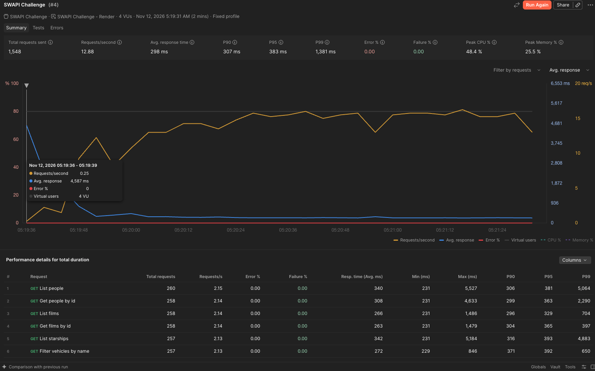
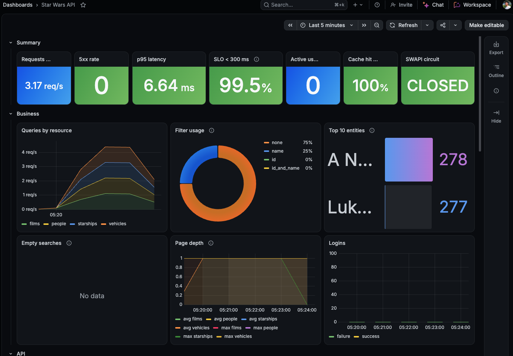
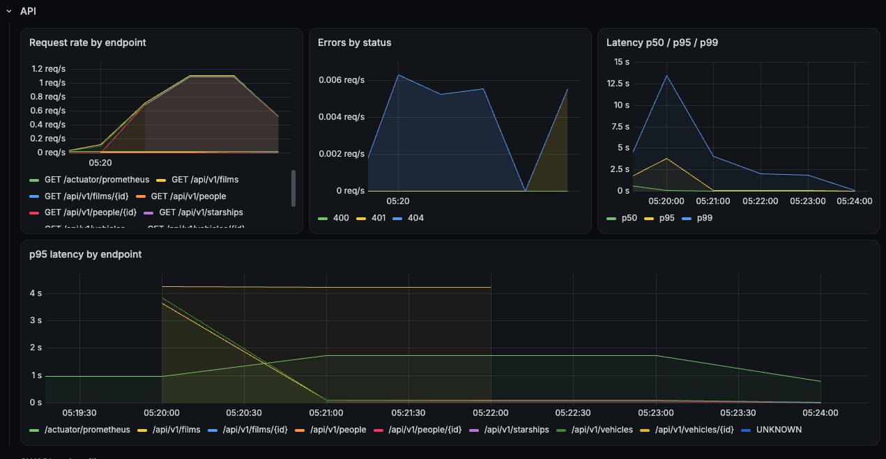
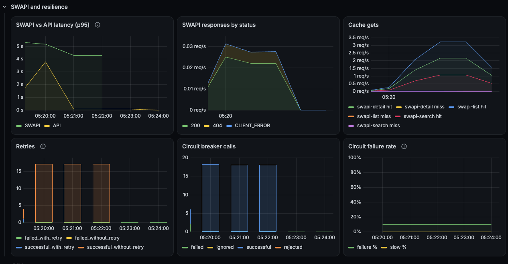
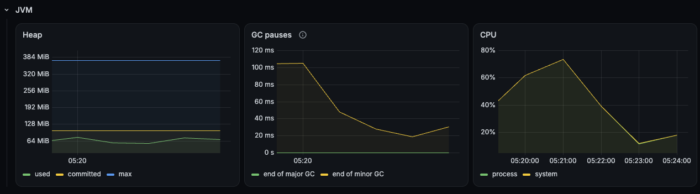
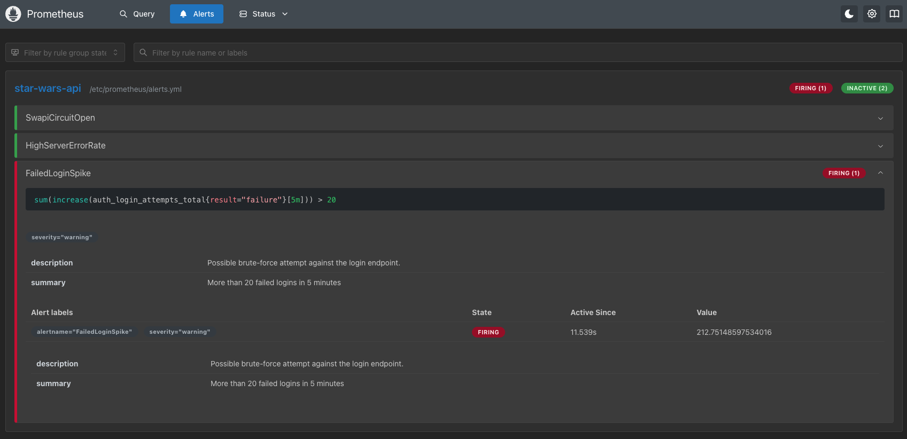
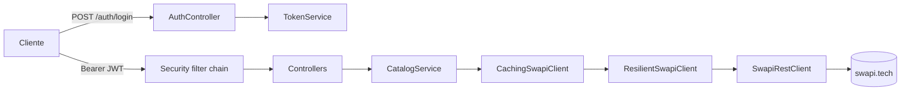
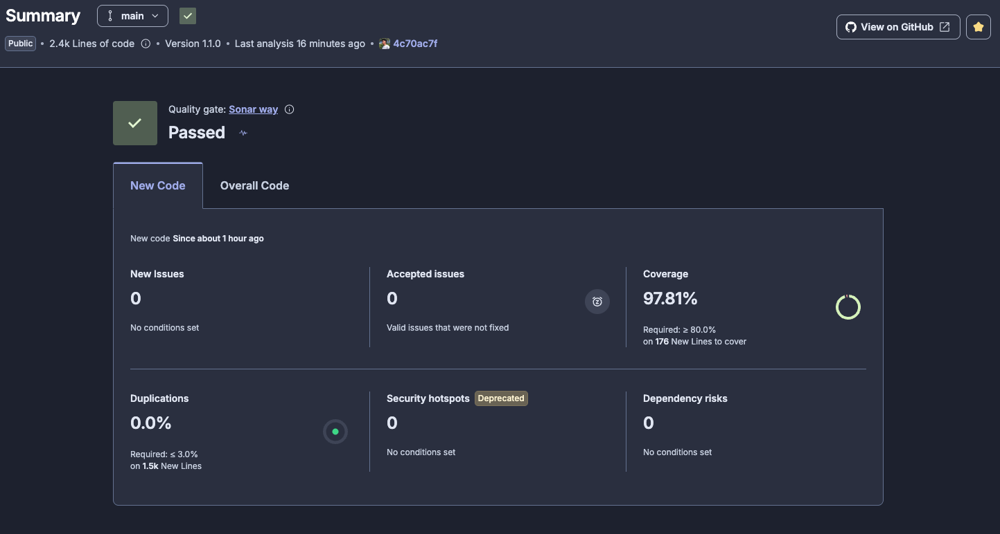
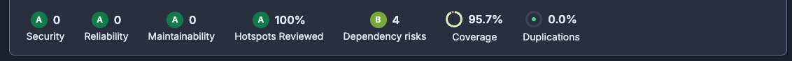

# Star Wars API

[](https://github.com/MaximilianoTRZ/star-wars-api/actions/workflows/ci.yml)
[](https://sonarcloud.io/summary/new_code?id=MaximilianoTRZ_star-wars-api)
[](https://sonarcloud.io/summary/new_code?id=MaximilianoTRZ_star-wars-api)

API REST sobre [SWAPI](https://www.swapi.tech) que expone People, Films, Starships y Vehicles con paginación uniforme, filtros por ID y/o nombre y autenticación JWT. Java 21 + Spring Boot 4.1.

El diseño, las fases de implementación y las decisiones están en el [RFC](docs/RFC.md) y en los [ADRs](docs/adr/).

## Qué es

| # | Requisito | Cómo se cumple |
|---|---|---|
| 1 | Integración con SWAPI | `SwapiClient` sobre `RestClient`, aislado detrás de una interfaz, con timeouts y mapeo de errores |
| 2 | Listado paginado | `PageResponse<T>` uniforme para los 4 recursos, aunque SWAPI no pagine films ni búsquedas |
| 3 | Filtrado por ID y/o nombre | `CatalogService` elige la estrategia según la combinación de filtros |
| 4 | Login seguro, autenticación y autorización | JWT HS256 emitido por `POST /api/v1/auth/login` y validado con OAuth2 Resource Server; scope `catalog:read`; contraseñas con BCrypt |
| 5 | Documentación | Este README, Swagger UI, Javadoc, el [RFC](docs/RFC.md) y los [ADRs](docs/adr/) |
| 6 | Tests unitarios y de integración | 131 tests: JUnit 5, Mockito, AssertJ, MockMvc, WireMock y `@SpringBootTest`. Ninguno llama a SWAPI real |
| 7 | Despliegue | Docker multi-stage en Render, con deploy automático desde `main` |

## Demo

- **Swagger UI:** https://star-wars-api-ailb.onrender.com/swagger-ui.html
- **Dashboard en vivo (Grafana Cloud):** https://magentaosprey3543.grafana.net/public-dashboards/c1eb26ffdec84e1fa902aa1efc509e6f
- **API:** https://star-wars-api-ailb.onrender.com/api/v1
- **Usuario demo:** `demo` / `6WOHUwBrXmIreNrDYxkq47Q5PuNV7mBq` (en local: `demo` / `demo123`)

Para probar desde Swagger UI: ejecutar `POST /api/v1/auth/login` con el usuario demo, copiar el `accessToken`, pegarlo en **Authorize** y llamar a cualquier endpoint del catálogo.

Corre en el plan gratuito de Render, que duerme la instancia después de un rato sin tráfico: el primer request puede tardar entre 30 y 60 s. Además, SWAPI tarda entre 2 y 9 s por request desde Render; las respuestas quedan en caché una hora (ver [Resiliencia y caché](#resiliencia-y-caché)).

## Quick start

En local no hace falta configurar nada: el perfil por defecto trae valores de desarrollo.

### Con Docker Compose

```bash
docker compose up --build
```

Levanta la app en http://localhost:8080, Prometheus y Grafana (ver [Observabilidad](#observabilidad)).

### Con Docker

```bash
docker build -t star-wars-api .
docker run -p 8080:8080 star-wars-api
```

### Con Maven

```bash
./mvnw spring-boot:run
```

Después abrir http://localhost:8080/swagger-ui.html y hacer login con `demo` / `demo123`.

## Configuración

| Variable | Descripción | Default local | En `prod` |
|---|---|---|---|
| `JWT_SECRET` | Clave HMAC-SHA256 para firmar los tokens, mínimo 32 bytes | Valor de desarrollo | Obligatoria |
| `DEMO_USER_PASSWORD` | Contraseña del usuario `demo` | `demo123` | Obligatoria |
| `SPRING_PROFILES_ACTIVE` | Perfil activo | — | `prod` |
| `METRICS_USERNAME` | Usuario del scrape de `/actuator/prometheus` | — | `grafana` por defecto |
| `METRICS_PASSWORD` | Contraseña del scrape, mínimo 16 caracteres | — (en local el endpoint no pide credenciales) | Obligatoria |
| `GRAFANA_ADMIN_PASSWORD` | Admin de Grafana en el compose local | `admin` | — |

- En el perfil `prod`, si falta una variable o el secreto es corto, la app no arranca (fail fast).
- Para generar un secreto: `openssl rand -base64 48`.
- [`.env.example`](.env.example) muestra el formato. `docker compose` lee `.env` si existe.

## Uso

```bash
BASE=http://localhost:8080

# 1. Login
TOKEN=$(curl -s -X POST $BASE/api/v1/auth/login \
  -H 'Content-Type: application/json' \
  -d '{"username":"demo","password":"demo123"}' | jq -r .accessToken)

# 2. Listar (page base 1, size entre 1 y 100, default 10)
curl -s "$BASE/api/v1/people?page=1&size=3" -H "Authorization: Bearer $TOKEN"
```

```json
{
  "content": [
    { "id": "1", "name": "Luke Skywalker" },
    { "id": "2", "name": "C-3PO" },
    { "id": "3", "name": "R2-D2" }
  ],
  "page": 1,
  "size": 3,
  "totalElements": 82,
  "totalPages": 28
}
```

```bash
# 3. Filtrar por nombre (contiene, sin distinguir mayúsculas). En films el filtro es "title"
curl -s "$BASE/api/v1/people?name=skywalker" -H "Authorization: Bearer $TOKEN"
curl -s "$BASE/api/v1/films?title=jedi" -H "Authorization: Bearer $TOKEN"

# 4. Filtrar por ID, o por ID y nombre a la vez
curl -s "$BASE/api/v1/starships?id=9" -H "Authorization: Bearer $TOKEN"
curl -s "$BASE/api/v1/people?id=1&name=luke" -H "Authorization: Bearer $TOKEN"

# 5. Detalle
curl -s "$BASE/api/v1/starships/9" -H "Authorization: Bearer $TOKEN"
```

```json
{
  "id": "9",
  "name": "Death Star",
  "model": "DS-1 Orbital Battle Station",
  "manufacturer": "Imperial Department of Military Research, Sienar Fleet Systems",
  "starshipClass": "Deep Space Mobile Battlestation",
  "costInCredits": "1000000000000",
  "length": "120000",
  "crew": "342,953",
  "passengers": "843,342",
  "cargoCapacity": "1000000000000",
  "hyperdriveRating": "4.0",
  "mglt": "10"
}
```

El mismo flujo está disponible como:

- **Colección de Postman** en [`docs/postman/`](docs/postman/): 46 requests con 139 aserciones y dos entornos, `local` y `render`. Se importan la colección y un entorno y se corre con el *Collection Runner*: el login guarda el token para el resto. Como pega contra SWAPI real, que tiene rate limit, conviene dejar una pausa entre requests (*Delay* en el runner). La carpeta "Rate limiting" va al final porque bloquea los logins durante hasta un minuto. Por línea de comandos:
  ```bash
  npx newman run docs/postman/star-wars-api.postman_collection.json \
    -e docs/postman/local.postman_environment.json --delay-request 500
  ```
- **Archivo `.http`** en [`docs/api-examples.http`](docs/api-examples.http), para IntelliJ o la extensión REST Client de VS Code.

### Endpoints

| Método y ruta | Parámetros | Respuesta |
|---|---|---|
| `POST /api/v1/auth/login` | body `{username, password}` | `{accessToken, tokenType, expiresIn}` |
| `GET /api/v1/people` | `page`, `size`, `id`, `name` | Página de `{id, name}` |
| `GET /api/v1/films` | `page`, `size`, `id`, `title` | Página de `{id, title}` |
| `GET /api/v1/starships` | `page`, `size`, `id`, `name` | Página de `{id, name}` |
| `GET /api/v1/vehicles` | `page`, `size`, `id`, `name` | Página de `{id, name}` |
| `GET /api/v1/{recurso}/{id}` | — | Detalle completo |

Reglas del contrato:

- Los listados devuelven un resumen; el detalle completo sale solo de `/{id}` ([ADR-003](docs/adr/ADR-003.md)).
- Una página fuera de rango devuelve `content: []` con los totales reales.
- Un ID inexistente en el listado devuelve una página vacía (200); en `/{id}` devuelve 404.

### Errores

Todos los errores siguen el formato `ProblemDetail` ([RFC 9457](https://www.rfc-editor.org/rfc/rfc9457), [ADR-013](docs/adr/ADR-013.md)) con `Content-Type: application/problem+json`:

```json
{
  "type": "/problems/resource-not-found",
  "title": "Resource not found",
  "status": 404,
  "detail": "No people found with id 9999",
  "instance": "/api/v1/people/9999",
  "timestamp": "2026-11-12T06:45:56Z",
  "requestId": "3f1c2a9e-7b4d-4e8a-9c1f-2d6b5e8a0f13"
}
```

`requestId` es el mismo valor del header `X-Request-Id` de la respuesta y de las líneas de log del request (ver [Logs y correlación](#logs-y-correlación)).

El campo `type` identifica el problema. Los de la API son:

| Status | `type` | Cuándo |
|---|---|---|
| 400 | `/problems/validation-error` | Un parámetro o un campo del body no cumple las validaciones (`size` > 100, `id` no numérico, `password` vacía); incluye `errors: [{field, message}]` |
| 401 | `/problems/unauthorized` | Falta el token, es inválido o está vencido; incluye `WWW-Authenticate: Bearer` |
| 401 | `/problems/invalid-credentials` | Login con usuario o contraseña incorrectos (mismo mensaje en ambos casos) |
| 403 | `/problems/forbidden` | El token no tiene el scope `catalog:read` |
| 404 | `/problems/resource-not-found` | El ID no existe en SWAPI |
| 429 | `/problems/too-many-requests` | Más de 5 intentos de login por minuto desde la misma IP; incluye `Retry-After` |
| 500 | `/problems/internal-error` | Error inesperado; la respuesta no expone detalles internos |
| 502 | `/problems/upstream-error` | SWAPI respondió algo que no se puede interpretar |
| 503 | `/problems/upstream-unavailable` | SWAPI caída, lenta (timeout de 10 s), con rate limit o con el circuito abierto; incluye `Retry-After` cuando se conoce |

Los errores genéricos de HTTP (ruta inexistente, método no soportado, body ilegible, tipo de parámetro inválido) usan `type: about:blank`, como indica el RFC 9457 cuando el problema no agrega nada al status, y su `title` es el del status.

## Resiliencia y caché

SWAPI es gratuita, desde Render tarda entre 2 y 9 s y limita a 100 requests por IP. El cliente se arma como una cadena de decorators: `CachingSwapiClient → ResilientSwapiClient → SwapiRestClient` ([ADR-007](docs/adr/ADR-007.md), [ADR-011](docs/adr/ADR-011.md)).

**Caché (Caffeine, en memoria):**

| Cache | Clave | Qué guarda |
|---|---|---|
| `swapi-list` | recurso + página + límite | Páginas del listado |
| `swapi-search` | recurso + término (sin espacios y en minúsculas) | Resultado completo de una búsqueda; todas sus páginas salen de ahí |
| `swapi-detail` | recurso + id | Detalle de una entidad |

- Hasta 1000 entradas por cache, vencen a la hora de escritas.
- No se cachean errores ni los 404, así un fallo transitorio no queda fijo.

**Retry:** hasta 3 intentos con backoff exponencial (200 ms, 400 ms) ante 5xx, errores de conexión y 429. Ante un 429 se espera el `Retry-After` de SWAPI si es de hasta 2 s; si es mayor, se responde 503 con ese mismo `Retry-After`. Los read timeouts (10 s) y los 4xx no se reintentan.

**Circuit breaker:**

| Parámetro | Valor |
|---|---|
| Ventana | últimas 20 llamadas (mínimo 10 para evaluar) |
| Abre con | 50% de fallas, u 80% de llamadas de más de 8 s |
| Abierto durante | 30 s, después prueba con 3 llamadas |
| Cuenta como falla | 5xx, 429, timeout o error de conexión; un 4xx no |

**Si SWAPI se cae:** lo que ya está en caché se sigue sirviendo. El resto responde 503 `upstream-unavailable`: primero tras los reintentos y, cuando el circuito se abre, al instante y con `Retry-After: 30`, sin llamar a SWAPI.

### Prueba de carga



Prueba de performance de Postman contra Render: 4 usuarios virtuales durante 2 minutos, recorriendo listados, detalles y una búsqueda.

- 1548 requests, 12,9 req/s y 0% de errores.
- Latencia promedio de 298 ms, con p90 de 307 ms y p95 de 383 ms. Casi todo ese tiempo es red hasta Render: la API responde en milisegundos desde la caché (ver el p95 de 6,64 ms en el [dashboard](#dashboard)).
- Los primeros requests tardan entre 4 y 5 s (máximos de hasta 5,5 s): son los misses que van a SWAPI. Después del primer pasaje, todo sale de la caché y la latencia queda plana.

## Observabilidad

Métricas con Micrometer y Prometheus, dashboard de Grafana y logs con correlation ID. En local, `docker compose` levanta Prometheus y Grafana. En producción, Grafana Cloud lee las métricas de Render y publica el mismo dashboard ([ADR-015](docs/adr/ADR-015.md)).

### Dashboard en vivo

**[Abrir el dashboard público](https://magentaosprey3543.grafana.net/public-dashboards/c1eb26ffdec84e1fa902aa1efc509e6f)**: métricas reales de la app en Render, sin login. Grafana Cloud las lee cada 1 minuto; para ver movimiento, hacer algunos requests a la [demo](https://star-wars-api-ailb.onrender.com/swagger-ui.html) y refrescar.

### Levantar el stack

```bash
docker compose up --build
```

| Servicio | URL | Acceso |
|---|---|---|
| API | http://localhost:8080 | — |
| Grafana | http://localhost:3000 | Anónimo como `Viewer`; admin `admin` / `GRAFANA_ADMIN_PASSWORD` (default `admin`) |
| Prometheus | http://localhost:9090 | Alertas en http://localhost:9090/alerts |

El dashboard **Star Wars API** queda como home de Grafana, sin pasos manuales: datasource, dashboard y alertas están provisionados desde `monitoring/`. Para ver datos, hacer algunos requests a la API.

### Endpoint de métricas

- **Local:** Actuator vive en el puerto de management **8081**, que el compose no publica. Solo Prometheus lo alcanza por la red interna (`app:8081/actuator/prometheus`, cada 15 s), sin credenciales.
- **Render:** publica un solo puerto, así que en el perfil `prod` Actuator lo comparte con la API. `/actuator/prometheus` exige HTTP Basic con `METRICS_USERNAME` / `METRICS_PASSWORD`; Grafana Cloud lo lee cada 1 minuto con la integración Metrics Endpoint. Si falta `METRICS_PASSWORD`, la app no arranca.
- Los probes `/livez` y `/readyz` se sirven en el puerto principal para el health check de Render.

### Dashboard

Las capturas son de Render (Grafana Cloud) durante la prueba de carga de [Resiliencia y caché](#prueba-de-carga), con la caché ya caliente. El dashboard tiene 5 filas.

#### Resumen y Negocio



| Widget | Qué muestra |
|---|---|
| Requests / s | Tráfico total de la API |
| 5xx rate | Porcentaje de respuestas 5xx: si sube, la API está fallando |
| p95 latency | Latencia que cumple el 95% de los requests. En la captura, 6,64 ms con el 100% de hit ratio; con la caché fría cada miss va a SWAPI y tarda segundos |
| SLO < 300 ms | Porcentaje de requests que responden en menos de 300 ms |
| Active users | Usuarios distintos que hicieron login en los últimos 15 min. La prueba de carga reusó un token, así que marca 0 |
| Cache hit ratio | Porcentaje de lecturas de SWAPI resueltas por la caché |
| SWAPI circuit | Estado del circuit breaker: `CLOSED` (normal), `OPEN` (SWAPI cortada) o `HALF_OPEN` (probando) |
| Queries by resource | Consultas por segundo a cada recurso |
| Filter usage | Cómo se filtra: sin filtro, por `id`, por `name` o por ambos |
| Top 10 entities | Entidades más vistas en el detalle, con el nombre que devuelve SWAPI |
| Empty searches | Porcentaje de búsquedas por nombre que no encontraron nada, por recurso |
| Page depth | Hasta qué página navegan (promedio y máximo por recurso) |
| Logins | Logins exitosos y fallidos; base de la alerta de fuerza bruta |

#### API



| Widget | Qué muestra |
|---|---|
| Request rate by endpoint | Tráfico por endpoint, agrupado por URI template: `/people/1` y `/people/2` son una sola serie. `UNKNOWN` agrupa los requests rechazados antes del ruteo, como un 401 sin token |
| Errors by status | Respuestas 4xx y 5xx por status. En la captura, los 404 de IDs inexistentes |
| Latency p50 / p95 / p99 | Latencia total. Se ve el pico inicial con la caché fría (SWAPI tarda entre 4 y 5 s desde Render) y cómo cae cuando la caché se llena |
| p95 latency by endpoint | La misma latencia, separada por endpoint |

#### SWAPI y resiliencia



| Widget | Qué muestra |
|---|---|
| SWAPI vs API latency (p95) | Latencia de SWAPI contra la de la API. Cuando la de la API queda por debajo, la caché está absorbiendo la latencia del proveedor |
| SWAPI responses by status | Respuestas de SWAPI por status. `CLIENT_ERROR` son llamadas sin respuesta (timeout o conexión cortada) |
| Cache gets | Hits y misses de cada cache (`swapi-list`, `swapi-search`, `swapi-detail`) |
| Retries | Llamadas a SWAPI según si necesitaron reintento y si terminaron bien |
| Circuit breaker calls | Llamadas exitosas, fallidas, ignoradas (4xx) y rechazadas con el circuito abierto |
| Circuit failure rate | Tasa de fallas y de llamadas lentas sobre la ventana de 20 llamadas; el circuito abre con 50% y 80%. En la captura, 10% de fallas de SWAPI que el retry absorbió |

#### JVM



| Widget | Qué muestra |
|---|---|
| Heap | Memoria usada, comprometida y máxima. En Render el máximo es 384 MiB: el 75% de los 512 MB del plan (`-XX:MaxRAMPercentage=75`) |
| GC pauses | Duración de las pausas del garbage collector |
| CPU | Uso de CPU del proceso y del sistema |

### Alertas

Provisionadas en Prometheus desde [`monitoring/alerts.yml`](monitoring/alerts.yml):

| Alerta | Condición |
|---|---|
| `SwapiCircuitOpen` | El circuito de SWAPI está abierto hace más de 1 min |
| `HighServerErrorRate` | Más de 5% de respuestas 5xx en 5 min |
| `FailedLoginSpike` | Más de 20 logins fallidos o bloqueados por rate limiting en 5 min |



La captura es del stack local después de una ráfaga de logins con contraseña incorrecta: `FailedLoginSpike` pasa a `FIRING` y las otras dos siguen inactivas.

### Métricas de negocio

| Métrica | Tipo | Tags | Pregunta que responde |
|---|---|---|---|
| `catalog.queries` | Counter | `resource`, `filter` (`none`, `id`, `name`, `id_and_name`) | ¿Qué se consulta y cómo se filtra? |
| `catalog.entity.views` | Counter | `resource`, `entity` | ¿Qué entidades son las más consultadas? |
| `catalog.searches.empty` | Counter | `resource` | ¿Qué porcentaje de búsquedas no encuentra nada? |
| `catalog.page.requested` | DistributionSummary | `resource` | ¿Hasta qué página navegan? |
| `auth.login.attempts` | Counter | `result` (`success`, `failure`, `blocked`) | ¿Hay intentos de fuerza bruta? |
| `auth.active.users` | Gauge | — | ¿Cuántos usuarios distintos hubo en 15 min? |

Se registran en `CatalogService` y `AuthController` a través de `CatalogMetrics` y `AuthMetrics`; los controllers no conocen Micrometer.

**Regla de cardinalidad:** cada combinación de tags es una serie distinta en Prometheus, así que los tags solo toman valores de un conjunto acotado. El texto que escribe el usuario nunca es un tag: una búsqueda por `name=luke` cuenta como `filter=name`, no como `name=luke`. `entity` se registra solo después de resolver una entidad con éxito, y su valor viene de SWAPI (unas 160 entidades), no del input. Por el mismo motivo las llamadas a SWAPI usan URI template, para que el tag `uri` de `http.client.requests` no tenga un valor por ID.

### Logs y correlación

- `CorrelationIdFilter` corre primero en la cadena: reusa el `X-Request-Id` del request si es corto y alfanumérico, o genera un UUID. Lo pone en el MDC y lo devuelve en el header `X-Request-Id`.
- El mismo ID aparece en cada línea de log del request y en el campo `requestId` de los errores, así una respuesta fallida se cruza con su log.
- En local los logs son texto legible; en `prod` son JSON con formato ECS, con `requestId`, `user` y los datos de cada evento como campos.
- Nunca se loguean contraseñas, tokens ni el header `Authorization`.
- Cada evento se loguea una vez, donde se decide ([ADR-018](docs/adr/ADR-018.md)):

| Evento | Nivel | Campos |
| --- | --- | --- |
| `GET /api/v1/people/{id} 200 1138ms` (una por request, sin probes ni Actuator) | `INFO`, `WARN` si es 5xx | `http.method`, `http.route`, `http.status`, `duration_ms`, `user` |
| `SWAPI attempt 1/3 failed (CONNECTION), retrying in 200ms` | `INFO` | `swapi.attempt`, `swapi.max_attempts`, `swapi.reason`, `swapi.wait_ms` |
| `SWAPI call succeeded on attempt 2` | `INFO` | `swapi.attempts` |
| `SWAPI call failed after 3 attempts (SERVER_ERROR)` / `... is not retried (TIMEOUT)` | `WARN` | `swapi.attempts`, `swapi.reason` |
| `SWAPI circuit breaker changed from CLOSED to OPEN` | `WARN` al abrir, `INFO` el resto | `circuit.from`, `circuit.to` |
| `Login succeeded for demo` | `INFO` | `user` |
| `Login failed from <ip>` (sin username) | `WARN` | `client.ip` |
| `Login blocked by rate limit for <ip>, retry in 42s` | `WARN` | `client.ip`, `retry_after_s` |
| `Request rejected as unauthenticated: <motivo>` / `Request forbidden` | `INFO` | `auth.failure` |

Para seguir una request en Render: copiar el `requestId` del error (o del header `X-Request-Id`) y buscarlo en **Logs**. Para más detalle, `LOGGING_LEVEL_DEV_STARWARS=DEBUG` en las variables de entorno muestra cada intento contra SWAPI (requiere reiniciar).

## Seguridad

- **Login:** `AuthenticationManager` + `DaoAuthenticationProvider`, con contraseñas en BCrypt guardadas en H2 ([ADR-005](docs/adr/ADR-005.md)). Usuario inexistente y contraseña incorrecta devuelven el mismo error.
- **Token:** JWT HS256 de 1 h con `iss`, `sub`, `iat`, `exp` y `scope: catalog:read`. Lo valida el OAuth2 Resource Server de Spring: firma, expiración e issuer ([ADR-004](docs/adr/ADR-004.md)).
- **Autorización:** los endpoints del catálogo exigen el scope `catalog:read`; estar autenticado no alcanza.
- **Deny by default:** solo son públicos el login, Swagger UI, el documento OpenAPI y los probes `/livez` y `/readyz`. Cualquier otra ruta sin token responde 401.
- **Métricas:** en local Actuator vive en el puerto de management (8081), que no se publica. En Render comparte el puerto público y `/actuator/prometheus` exige HTTP Basic con un usuario propio, que no sirve para llamar a la API ([ADR-015](docs/adr/ADR-015.md)).
- **Rate limiting del login:** 5 intentos por minuto por IP (Bucket4j). El 6º responde 429 con `Retry-After` antes de verificar las credenciales, y cuenta como `auth.login.attempts{result="blocked"}`. En Render la IP sale de `X-Forwarded-For`, pero de la que agrega el proxy de Render al final y no de la primera, que el cliente puede inventar; en local ese header se ignora. Los buckets viven en memoria y vencen a los 10 min sin uso: con varias réplicas el límite no se comparte (ver [Cómo lo escalaría](#cómo-lo-escalaría)).
- **CSRF deshabilitado:** la API es stateless y no usa cookies. El token viaja en el header `Authorization`, que el navegador no envía por su cuenta, así que no hay superficie para CSRF.
- **Fail fast:** en `prod` la app no arranca sin `JWT_SECRET` (mínimo 32 bytes), `DEMO_USER_PASSWORD` ni `METRICS_PASSWORD` (mínimo 16 caracteres).
- **Swagger UI público en producción** ([ADR-017](docs/adr/ADR-017.md)): la página carga sin token, pero cada llamada al catálogo lo exige.

## Arquitectura

Monolito modular, organizado por feature y con dependencias en una sola dirección ([ADR-001](docs/adr/ADR-001.md)):

```
dev.starwars
├── auth/       login, JWT y usuarios (api · service · domain · security)
├── catalog/    controllers, CatalogService y Paginator (api · service · domain)
├── swapi/      cliente de SWAPI: el único paquete que conoce su formato
├── common/     manejo de errores (ProblemDetail) y correlation ID
└── config/     RestClient, OpenAPI, reloj
```



`ArchitectureTest` (ArchUnit) verifica en cada build que `api` no use `swapi` ni repositorios, que `service` no dependa de `api`, que `swapi` no dependa de las features y que no haya ciclos.

## Tests

```bash
./mvnw verify
```

- Corre los unitarios (`*Test`, con Surefire) y los de integración (`*IT`, con Failsafe).
- El reporte de cobertura queda en `target/site/jacoco/index.html`; CI lo publica como artefacto. La cobertura de líneas es de 98%.

| Capa | Tipo | Herramientas |
|---|---|---|
| `Paginator`, `CatalogService`, `TokenService` | Unitario | JUnit 5, Mockito, AssertJ |
| Controllers, errores y seguridad | Slice | `@WebMvcTest`, `MockMvcTester`, `spring-security-test` |
| `SwapiRestClient` | Integración con stub | WireMock |
| Flujo punta a punta (`CatalogFlowIT`, `SecurityIT`) | `*IT` | `@SpringBootTest` con puerto aleatorio + WireMock |
| Caché, retry y circuit breaker (`SwapiResilienceIT`) | `*IT` | WireMock con escenarios y `CircuitBreakerRegistry` |
| Puerto de management y scrape protegido (`ManagementPortIT`, `MetricsScrapeIT`) | `*IT` | `@SpringBootTest` + `@LocalManagementPort` |

SWAPI se simula con WireMock usando respuestas reales guardadas en `src/test/resources/swapi/` ([ADR-009](docs/adr/ADR-009.md)). Para regenerar una:

```bash
curl -s "https://www.swapi.tech/api/people/1" | jq . > src/test/resources/swapi/people-1.json
```

## Calidad

`./mvnw verify` falla si:

- el formato no coincide con palantir-java-format (`./mvnw spotless:apply` lo corrige),
- la cobertura de líneas baja del 80%,
- se rompe una regla de arquitectura de `ArchitectureTest`.

En CI, además, cada push a `main` y cada PR se analizan en [SonarCloud](https://sonarcloud.io/summary/new_code?id=MaximilianoTRZ_star-wars-api) con el quality gate por defecto. Dependabot abre PRs semanales con las actualizaciones de Maven y de GitHub Actions.





Quality gate "Sonar way" en verde: 0 issues nuevos, 97,8% de cobertura en código nuevo (95,7% en total), 0% de duplicación y rating A en seguridad, confiabilidad y mantenibilidad. Dependabot mantiene las dependencias al día.

## Decisiones de diseño

| ADR | Decisión |
|---|---|
| [001](docs/adr/ADR-001.md) | Monolito modular en capas |
| [002](docs/adr/ADR-002.md) | Paginación propia y uniforme |
| [003](docs/adr/ADR-003.md) | Listados con resumen; detalle solo en `/{id}` |
| [004](docs/adr/ADR-004.md) | JWT stateless con OAuth2 Resource Server nativo |
| [005](docs/adr/ADR-005.md) | Usuarios en H2 en memoria |
| [006](docs/adr/ADR-006.md) | Spring Boot 4.1.2 con Java 21 |
| [007](docs/adr/ADR-007.md) | Caché en la capa cliente, por decorator |
| [008](docs/adr/ADR-008.md) | `RestClient` sincrónico + virtual threads |
| [009](docs/adr/ADR-009.md) | WireMock con fixtures reales |
| [010](docs/adr/ADR-010.md) | Render free tier con Docker |
| [011](docs/adr/ADR-011.md) | Resilience4j para retry y circuit breaker |
| [012](docs/adr/ADR-012.md) | `wiremock-standalone` en tests |
| [013](docs/adr/ADR-013.md) | Errores con Problem Details (RFC 9457) |
| [014](docs/adr/ADR-014.md) | Calidad de código desde la Fase 0 |
| [015](docs/adr/ADR-015.md) | Dashboard público con Grafana Cloud y scrape autenticado |
| [016](docs/adr/ADR-016.md) | GraphQL y MCP como adaptadores del mismo `CatalogService` |
| [017](docs/adr/ADR-017.md) | Swagger UI y GraphiQL públicos en producción |
| [018](docs/adr/ADR-018.md) | Estrategia de logging para producción |

## ¿Por qué no microservicios?

El dominio es uno solo: cuatro recursos de lectura que vienen del mismo proveedor, y el único estado propio son los usuarios. Separarlo en servicios agregaría latencia de red, despliegues coordinados, trazas distribuidas y fallas parciales, sin un beneficio concreto: no hay equipos distintos ni cargas que escalen distinto. Los límites entre módulos (`auth`, `catalog`, `swapi`) están marcados por paquetes con dependencias en una sola dirección, verificadas por ArchUnit, y el cliente de SWAPI está detrás de una interfaz: extraer un módulo más adelante no exige reescribir. El [RFC](docs/RFC.md#en-un-ecosistema-de-microservicios) lista lo que se sumaría en un ecosistema de varios servicios.

## Cómo lo escalaría

1. **Réplicas stateless detrás de un load balancer.** La app no guarda sesión: cualquier réplica valida cualquier token. Lo que hoy vive en memoria pasa a Redis para que lo compartan todas: la caché de SWAPI (Caffeine → Redis con el mismo TTL) y el rate limiting del login (Bucket4j tiene backend para Redis; `LoginRateLimiter` es la interfaz que se reemplaza).
2. **Identity Provider externo** (Keycloak, Auth0, Cognito). El Resource Server ya valida JWT estándar: alcanza con configurar `issuer-uri` en lugar de la clave HMAC y emitir los tokens afuera. El login y los usuarios en H2 desaparecen de la app.
3. **Sincronizar SWAPI a una base propia** (PostgreSQL o MongoDB) con un job periódico. Los datos son casi estáticos, así que la API deja de depender de la disponibilidad y el rate limit de SWAPI, y puede paginar y filtrar con índices en lugar de en memoria.
4. **Microservicios solo si aparece la necesidad:** equipos separados o cargas muy distintas entre auth y catálogo. En ese caso irían detrás de un API Gateway, con OpenTelemetry para las trazas y lo listado en la sección "En un ecosistema de microservicios" del RFC.

## Licencia

[MIT](LICENSE)
