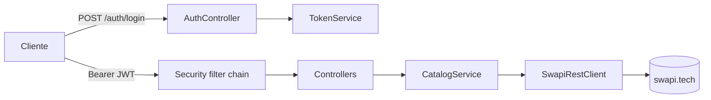

# Star Wars API

[](https://github.com/MaximilianoTRZ/star-wars-api/actions/workflows/ci.yml)
[](https://sonarcloud.io/summary/new_code?id=MaximilianoTRZ_star-wars-api)
[](https://sonarcloud.io/summary/new_code?id=MaximilianoTRZ_star-wars-api)

API REST sobre [SWAPI](https://www.swapi.tech) que expone People, Films, Starships y Vehicles con paginación uniforme, filtros por ID y/o nombre y autenticación JWT. Java 21 + Spring Boot 4.1.

El diseño, las fases de implementación y las decisiones están en el [RFC](docs/RFC.md) y en los [ADRs](docs/adr/).

## Qué es

| # | Requisito | Cómo se cumple |
|---|---|---|
| 1 | Integración con SWAPI | `SwapiClient` sobre `RestClient`, aislado detrás de una interfaz, con timeouts y mapeo de errores |
| 2 | Listado paginado | `PageResponse<T>` uniforme para los 4 recursos, aunque SWAPI no pagine films ni búsquedas |
| 3 | Filtrado por ID y/o nombre | `CatalogService` elige la estrategia según la combinación de filtros |
| 4 | Login seguro, autenticación y autorización | JWT HS256 emitido por `POST /api/v1/auth/login` y validado con OAuth2 Resource Server; scope `catalog:read`; contraseñas con BCrypt |
| 5 | Documentación | Este README, Swagger UI, Javadoc, el [RFC](docs/RFC.md) y los [ADRs](docs/adr/) |
| 6 | Tests unitarios y de integración | 131 tests: JUnit 5, Mockito, AssertJ, MockMvc, WireMock y `@SpringBootTest`. Ninguno llama a SWAPI real |
| 7 | Despliegue | Docker multi-stage en Render, con deploy automático desde `main` |

## Demo

- **Swagger UI:** https://star-wars-api-ailb.onrender.com/swagger-ui.html
- **API:** https://star-wars-api-ailb.onrender.com/api/v1
- **Usuario demo:** `demo` / `6WOHUwBrXmIreNrDYxkq47Q5PuNV7mBq` (en local: `demo` / `demo123`)

Para probar desde Swagger UI: ejecutar `POST /api/v1/auth/login` con el usuario demo, copiar el `accessToken`, pegarlo en **Authorize** y llamar a cualquier endpoint del catálogo.

Corre en el plan gratuito de Render, que duerme la instancia después de un rato sin tráfico: el primer request puede tardar entre 30 y 60 s. Además, SWAPI tarda entre 2 y 9 s por request desde Render.

## Quick start

En local no hace falta configurar nada: el perfil por defecto trae valores de desarrollo.

### Con Docker Compose

```bash
docker compose up --build
```

### Con Docker

```bash
docker build -t star-wars-api .
docker run -p 8080:8080 star-wars-api
```

### Con Maven

```bash
./mvnw spring-boot:run
```

Después abrir http://localhost:8080/swagger-ui.html y hacer login con `demo` / `demo123`.

## Configuración

| Variable | Descripción | Default local | En `prod` |
|---|---|---|---|
| `JWT_SECRET` | Clave HMAC-SHA256 para firmar los tokens, mínimo 32 bytes | Valor de desarrollo | Obligatoria |
| `DEMO_USER_PASSWORD` | Contraseña del usuario `demo` | `demo123` | Obligatoria |
| `SPRING_PROFILES_ACTIVE` | Perfil activo | — | `prod` |

- En el perfil `prod`, si falta una variable o el secreto es corto, la app no arranca (fail fast).
- Para generar un secreto: `openssl rand -base64 48`.
- [`.env.example`](.env.example) muestra el formato. `docker compose` lee `.env` si existe.

## Uso

```bash
BASE=http://localhost:8080

# 1. Login
TOKEN=$(curl -s -X POST $BASE/api/v1/auth/login \
  -H 'Content-Type: application/json' \
  -d '{"username":"demo","password":"demo123"}' | jq -r .accessToken)

# 2. Listar (page base 1, size entre 1 y 100, default 10)
curl -s "$BASE/api/v1/people?page=1&size=3" -H "Authorization: Bearer $TOKEN"
```

```json
{
  "content": [
    { "id": "1", "name": "Luke Skywalker" },
    { "id": "2", "name": "C-3PO" },
    { "id": "3", "name": "R2-D2" }
  ],
  "page": 1,
  "size": 3,
  "totalElements": 82,
  "totalPages": 28
}
```

```bash
# 3. Filtrar por nombre (contiene, sin distinguir mayúsculas). En films el filtro es "title"
curl -s "$BASE/api/v1/people?name=skywalker" -H "Authorization: Bearer $TOKEN"
curl -s "$BASE/api/v1/films?title=jedi" -H "Authorization: Bearer $TOKEN"

# 4. Filtrar por ID, o por ID y nombre a la vez
curl -s "$BASE/api/v1/starships?id=9" -H "Authorization: Bearer $TOKEN"
curl -s "$BASE/api/v1/people?id=1&name=luke" -H "Authorization: Bearer $TOKEN"

# 5. Detalle
curl -s "$BASE/api/v1/starships/9" -H "Authorization: Bearer $TOKEN"
```

```json
{
  "id": "9",
  "name": "Death Star",
  "model": "DS-1 Orbital Battle Station",
  "manufacturer": "Imperial Department of Military Research, Sienar Fleet Systems",
  "starshipClass": "Deep Space Mobile Battlestation",
  "costInCredits": "1000000000000",
  "length": "120000",
  "crew": "342,953",
  "passengers": "843,342",
  "cargoCapacity": "1000000000000",
  "hyperdriveRating": "4.0",
  "mglt": "10"
}
```

El mismo flujo está disponible como:

- **Colección de Postman** en [`docs/postman/`](docs/postman/): 35 requests con 123 aserciones y dos entornos, `local` y `render`. Se importan la colección y un entorno y se corre con el *Collection Runner*: el login guarda el token para el resto. Como pega contra SWAPI real, que tiene rate limit, conviene dejar una pausa entre requests (*Delay* en el runner). Por línea de comandos:
  ```bash
  npx newman run docs/postman/star-wars-api.postman_collection.json \
    -e docs/postman/local.postman_environment.json --delay-request 500
  ```
- **Archivo `.http`** en [`docs/api-examples.http`](docs/api-examples.http), para IntelliJ o la extensión REST Client de VS Code.

### Endpoints

| Método y ruta | Parámetros | Respuesta |
|---|---|---|
| `POST /api/v1/auth/login` | body `{username, password}` | `{accessToken, tokenType, expiresIn}` |
| `GET /api/v1/people` | `page`, `size`, `id`, `name` | Página de `{id, name}` |
| `GET /api/v1/films` | `page`, `size`, `id`, `title` | Página de `{id, title}` |
| `GET /api/v1/starships` | `page`, `size`, `id`, `name` | Página de `{id, name}` |
| `GET /api/v1/vehicles` | `page`, `size`, `id`, `name` | Página de `{id, name}` |
| `GET /api/v1/{recurso}/{id}` | — | Detalle completo |

Reglas del contrato:

- Los listados devuelven un resumen; el detalle completo sale solo de `/{id}` ([ADR-003](docs/adr/ADR-003.md)).
- Una página fuera de rango devuelve `content: []` con los totales reales.
- Un ID inexistente en el listado devuelve una página vacía (200); en `/{id}` devuelve 404.

### Errores

Todos los errores siguen el formato `ProblemDetail` ([RFC 9457](https://www.rfc-editor.org/rfc/rfc9457), [ADR-013](docs/adr/ADR-013.md)) con `Content-Type: application/problem+json`:

```json
{
  "type": "/problems/resource-not-found",
  "title": "Resource not found",
  "status": 404,
  "detail": "No people found with id 9999",
  "instance": "/api/v1/people/9999",
  "timestamp": "2026-11-12T06:45:56Z"
}
```

El campo `type` identifica el problema. Los de la API son:

| Status | `type` | Cuándo |
|---|---|---|
| 400 | `/problems/validation-error` | Un parámetro o un campo del body no cumple las validaciones (`size` > 100, `id` no numérico, `password` vacía); incluye `errors: [{field, message}]` |
| 401 | `/problems/unauthorized` | Falta el token, es inválido o está vencido; incluye `WWW-Authenticate: Bearer` |
| 401 | `/problems/invalid-credentials` | Login con usuario o contraseña incorrectos (mismo mensaje en ambos casos) |
| 403 | `/problems/forbidden` | El token no tiene el scope `catalog:read` |
| 404 | `/problems/resource-not-found` | El ID no existe en SWAPI |
| 500 | `/problems/internal-error` | Error inesperado; la respuesta no expone detalles internos |
| 502 | `/problems/upstream-error` | SWAPI respondió algo que no se puede interpretar |
| 503 | `/problems/upstream-unavailable` | SWAPI caída, lenta (timeout de 10 s) o con rate limit; incluye `Retry-After` cuando SWAPI lo manda |

Los errores genéricos de HTTP (ruta inexistente, método no soportado, body ilegible, tipo de parámetro inválido) usan `type: about:blank`, como indica el RFC 9457 cuando el problema no agrega nada al status, y su `title` es el del status.

## Seguridad

- **Login:** `AuthenticationManager` + `DaoAuthenticationProvider`, con contraseñas en BCrypt guardadas en H2 ([ADR-005](docs/adr/ADR-005.md)). Usuario inexistente y contraseña incorrecta devuelven el mismo error.
- **Token:** JWT HS256 de 1 h con `iss`, `sub`, `iat`, `exp` y `scope: catalog:read`. Lo valida el OAuth2 Resource Server de Spring: firma, expiración e issuer ([ADR-004](docs/adr/ADR-004.md)).
- **Autorización:** los endpoints del catálogo exigen el scope `catalog:read`; estar autenticado no alcanza.
- **Deny by default:** solo son públicos el login, Swagger UI, el documento OpenAPI y `/actuator/health` e `/actuator/info`. Cualquier otra ruta sin token responde 401.
- **CSRF deshabilitado:** la API es stateless y no usa cookies. El token viaja en el header `Authorization`, que el navegador no envía por su cuenta, así que no hay superficie para CSRF.
- **Fail fast:** en `prod` la app no arranca sin `JWT_SECRET` (mínimo 32 bytes) ni `DEMO_USER_PASSWORD`.
- **Swagger UI público en producción** ([ADR-017](docs/adr/ADR-017.md)): la página carga sin token, pero cada llamada al catálogo lo exige.

## Arquitectura

Monolito modular, organizado por feature y con dependencias en una sola dirección ([ADR-001](docs/adr/ADR-001.md)):

```
dev.starwars
├── auth/       login, JWT y usuarios (api · service · domain · security)
├── catalog/    controllers, CatalogService y Paginator (api · service · domain)
├── swapi/      cliente de SWAPI: el único paquete que conoce su formato
├── common/     manejo de errores (ProblemDetail)
└── config/     RestClient, OpenAPI, reloj
```



`ArchitectureTest` (ArchUnit) verifica en cada build que `api` no use `swapi` ni repositorios, que `service` no dependa de `api`, que `swapi` no dependa de las features y que no haya ciclos.

## Tests

```bash
./mvnw verify
```

- Corre los unitarios (`*Test`, con Surefire) y los de integración (`*IT`, con Failsafe).
- El reporte de cobertura queda en `target/site/jacoco/index.html`; CI lo publica como artefacto. La cobertura de líneas es de 98%.

| Capa | Tipo | Herramientas |
|---|---|---|
| `Paginator`, `CatalogService`, `TokenService` | Unitario | JUnit 5, Mockito, AssertJ |
| Controllers, errores y seguridad | Slice | `@WebMvcTest`, `MockMvcTester`, `spring-security-test` |
| `SwapiRestClient` | Integración con stub | WireMock |
| Flujo punta a punta (`CatalogFlowIT`, `SecurityIT`) | `*IT` | `@SpringBootTest` con puerto aleatorio + WireMock |

SWAPI se simula con WireMock usando respuestas reales guardadas en `src/test/resources/swapi/` ([ADR-009](docs/adr/ADR-009.md)). Para regenerar una:

```bash
curl -s "https://www.swapi.tech/api/people/1" | jq . > src/test/resources/swapi/people-1.json
```

## Calidad

`./mvnw verify` falla si:

- el formato no coincide con palantir-java-format (`./mvnw spotless:apply` lo corrige),
- la cobertura de líneas baja del 80%,
- se rompe una regla de arquitectura de `ArchitectureTest`.

En CI, además, cada push a `main` y cada PR se analizan en [SonarCloud](https://sonarcloud.io/summary/new_code?id=MaximilianoTRZ_star-wars-api) con el quality gate por defecto. Dependabot abre PRs semanales con las actualizaciones de Maven y de GitHub Actions.

## Decisiones de diseño

| ADR | Decisión |
|---|---|
| [001](docs/adr/ADR-001.md) | Monolito modular en capas |
| [002](docs/adr/ADR-002.md) | Paginación propia y uniforme |
| [003](docs/adr/ADR-003.md) | Listados con resumen; detalle solo en `/{id}` |
| [004](docs/adr/ADR-004.md) | JWT stateless con OAuth2 Resource Server nativo |
| [005](docs/adr/ADR-005.md) | Usuarios en H2 en memoria |
| [006](docs/adr/ADR-006.md) | Spring Boot 4.1.2 con Java 21 |
| [007](docs/adr/ADR-007.md) | Caché en la capa cliente, por decorator |
| [008](docs/adr/ADR-008.md) | `RestClient` sincrónico + virtual threads |
| [009](docs/adr/ADR-009.md) | WireMock con fixtures reales |
| [010](docs/adr/ADR-010.md) | Render free tier con Docker |
| [011](docs/adr/ADR-011.md) | Resilience4j para retry y circuit breaker |
| [012](docs/adr/ADR-012.md) | `wiremock-standalone` en tests |
| [013](docs/adr/ADR-013.md) | Errores con Problem Details (RFC 9457) |
| [014](docs/adr/ADR-014.md) | Calidad de código desde la Fase 0 |
| [015](docs/adr/ADR-015.md) | Dashboard público con Grafana Cloud y scrape autenticado |
| [016](docs/adr/ADR-016.md) | GraphQL y MCP como adaptadores del mismo `CatalogService` |
| [017](docs/adr/ADR-017.md) | Swagger UI y GraphiQL públicos en producción |

## ¿Por qué no microservicios?

El dominio es uno solo: cuatro recursos de lectura que vienen del mismo proveedor, y el único estado propio son los usuarios. Separarlo en servicios agregaría latencia de red, despliegues coordinados, trazas distribuidas y fallas parciales, sin un beneficio concreto: no hay equipos distintos ni cargas que escalen distinto. Los límites entre módulos están marcados por paquetes con dependencias en una sola dirección, verificadas por ArchUnit, así que extraer uno más adelante no exige reescribir.

## Licencia

[MIT](LICENSE)
