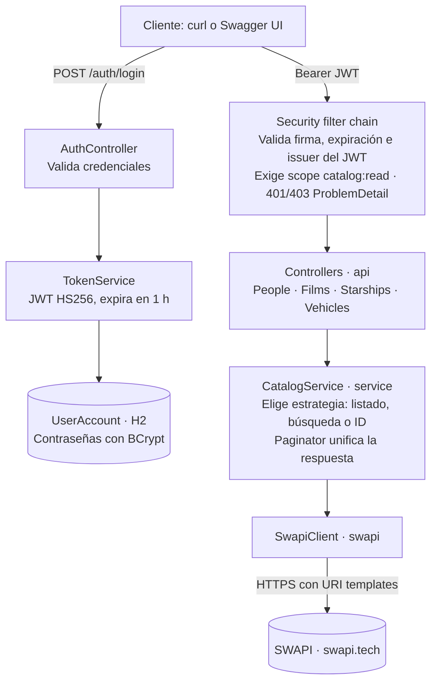

# RFC — Star Wars API: spec por fase

12/11/2026

## 1. Contexto y objetivos

API REST en Java 21 + Spring Boot 4.1 que expone People, Films, Starships y Vehicles de [SWAPI](https://www.swapi.tech) con paginación uniforme, filtros por ID y/o nombre y autenticación JWT. Se entrega como repositorio público, con la app desplegada en una URL pública.

La Fase 1 cumple todos los requisitos funcionales y es entregable por sí sola. Las Fases 2 a 5 suman resiliencia, observabilidad, extras de seguridad y dos formas nuevas de consumir el catálogo (GraphQL y MCP), sin tocar el contrato REST. La calidad de código (SonarCloud, cobertura, reglas de arquitectura, formato) se verifica en CI desde el primer commit.

### Requisitos → solución

| # | Requisito | Cómo se cumple | Fase |
| --- | --- | --- | --- |
| 1 | Integración con SWAPI | `SwapiClient` sobre `RestClient`, aislado detrás de una interfaz | F1 |
| 2 | Listado paginado | `PageResponse<T>` uniforme para los 4 recursos, aunque SWAPI no pagine | F1 |
| 3 | Filtrado por ID y/o nombre | `SearchCriteria` + estrategia de resolución por combinación de filtros | F1 |
| 4 | Login seguro, autenticación y autorización | JWT HS256 emitido por `/auth/login`, validado con OAuth2 Resource Server, scope `catalog:read`, BCrypt | F1 |
| 5 | Documentación | README, OpenAPI/Swagger UI, Javadoc en clases clave, este RFC y ADRs | F0–F1 |
| 6 | Tests unitarios y de integración | JUnit 5, Mockito, AssertJ, MockMvc, WireMock; JaCoCo con umbral | F0–F1 |
| 7 | Despliegue | Docker multi-stage + Render, desplegado desde la Fase 0 | F0 |

### No-objetivos

- Microservicios: ver ADR-001.
- Persistir los datos de SWAPI en una base propia (queda como evolución en "Cómo lo escalaría").
- Frontend, registro self-service de usuarios y refresh tokens.
- Otra nube que no sea Render (ADR-010).

### Criterios de éxito

- Todos los requisitos verificados contra la URL pública con los ejemplos curl del README, Swagger UI y GraphiQL.
- `./mvnw verify` en verde en CI, sin llamadas reales a SWAPI en los tests.
- Quality gate de SonarCloud en verde y cobertura de líneas ≥ 80%.
- Un reviewer levanta la app en menos de 5 minutos con un solo comando (`docker compose up` o `./mvnw spring-boot:run`).

### Restricciones conocidas de SWAPI

La API externa no es uniforme, y eso condiciona el diseño. Verificado contra `https://www.swapi.tech/api` al capturar los fixtures de test:

- El listado (`/people?page=&limit=`) pagina y trae solo `uid`, `name` y `url` por ítem.
- La búsqueda (`/people?name=`) devuelve `result` sin paginación, con el detalle completo de cada ítem.
- `/films` no pagina y se filtra por `title`, no por `name`.
- Una página fuera de rango (`page=999`) no da error: devuelve **la última página** con 200, así que el servicio tiene que detectar `page > total_pages`.
- `limit` no tiene máximo: `limit=1000` devuelve todo en una página.
- La búsqueda por `name`/`title` es "contiene" y no distingue mayúsculas (`skywalker` trae 3 personas).
- Un ID inexistente (o no numérico) devuelve 404 con `{"message": "not found"}`.
- Casi todos los valores de `properties` son strings (`"172"`, `"n/a"`); `episode_id` es numérico.
- **Rate limit por IP:** `x-ratelimit-limit: 100`. En Render la IP de salida es compartida entre servicios, así que un 429 puede aparecer con poco tráfico propio.
- **Latencia:** desde Render, SWAPI tarda entre 2 y 9 s por request.

## 2. Principios y convenciones transversales

Estas reglas aplican a todas las fases. Una work unit no está terminada si viola alguna.

### Principios de diseño

- **KISS / YAGNI:** monolito modular en capas. Cada pieza nueva se justifica por un requisito o por un riesgo concreto. Esto aplica también a las herramientas de calidad: configuración mínima, la que necesita una API MVC.
- **Dependencias en una sola dirección:** `api` → `service` → `client`. Ninguna capa conoce a la de arriba y el dominio no depende de clases web. ArchUnit lo verifica.
- **Inmutabilidad:** records para DTOs, value objects y configuración.
- **Fail fast:** validación en el borde (Bean Validation) y configuración validada al arrancar. Si falta un secreto en `prod`, o no cumple su largo mínimo, la app no levanta.
- **Seguridad por defecto:** deny-by-default en la cadena de filtros, sin secretos en el repo, mismo mensaje de error para usuario inexistente y contraseña incorrecta.
- **Errores explícitos:** excepciones de dominio tipadas, traducidas a HTTP en un único punto, siempre como Problem Details (ADR-013).

### Principios SOLID

Aplican a todas las fases. Cada fase tiene una subsección "SOLID en esta fase" con las decisiones concretas que los sostienen.

| Principio | Cómo se aplica en el proyecto |
| --- | --- |
| **S** — Responsabilidad única | Cada clase tiene un motivo para cambiar: los controllers solo traducen HTTP, `CatalogService` orquesta, `Paginator` pagina, `ProblemDetailFactory` arma errores, `TokenService` emite tokens. Las preocupaciones transversales (caché, resiliencia, métricas, correlación) viven en su propio componente |
| **O** — Abierto/cerrado | El comportamiento se extiende sin modificar lo existente: caché y resiliencia como decorators de `SwapiClient`, un recurso nuevo como un valor de `ResourceType` y de `CatalogResource`, un canal nuevo (GraphQL, MCP) como un adaptador sobre `CatalogService` |
| **L** — Sustitución de Liskov | Toda implementación de `SwapiClient` (HTTP, caché, resiliencia) respeta el mismo contrato: 404 → `Optional.empty()`, mismas excepciones. Los tests del contrato aplican a cualquiera de ellas |
| **I** — Segregación de interfaces | Interfaces chicas y enfocadas: `SwapiClient` tiene 3 métodos; la documentación OpenAPI común va en `CatalogApi`, separada de la lógica de los controllers |
| **D** — Inversión de dependencias | Las capas altas dependen de abstracciones: `CatalogService` depende de `SwapiClient`, no de `RestClient`; `TokenService` recibe un `Clock`; las métricas reciben un `MeterRegistry`; la configuración entra por records de propiedades. Todo se inyecta por constructor y se reemplaza en tests |

SOLID se aplica con el mismo criterio que el resto: sin interfaces de una sola implementación que no tengan un motivo (un test, un decorator o un reemplazo previsto).

### Estructura de paquetes (package-by-feature)

```
dev.starwars
├── StarWarsApiApplication.java
├── config/          RestClient, OpenAPI, caché, resiliencia, propiedades tipadas
├── auth/
│   ├── api/         AuthController, LoginRequest, TokenResponse
│   ├── service/     TokenService, UserAccountDetailsService, AuthMetrics
│   ├── domain/      UserAccount (entidad), UserAccountRepository, Role
│   └── security/    SecurityConfig, entry point y access denied handler, propiedades
├── catalog/
│   ├── api/         4 controllers + DTOs de salida
│   ├── service/     CatalogService, Paginator, CatalogMetrics
│   └── domain/      CatalogItem, SearchCriteria, PageRequestParams, PageResponse
├── swapi/           SwapiClient y sus decorators, ResourceType, modelos de SWAPI, excepciones
└── common/
    ├── exception/   GlobalExceptionHandler, ProblemDetailFactory
    └── web/         CorrelationIdFilter
```

En la Fase 5 se suman `catalog/graphql/` y `catalog/mcp/`, como adaptadores hermanos de `catalog/api/`.

### Convenciones de API

- Prefijo y versionado en la URL: `/api/v1`.
- JSON en camelCase. Paginación con `page` (base 1, igual que SWAPI) y `size` (default 10, máximo 100).
- Errores en formato `ProblemDetail` (RFC 9457) con `type`, `title`, `status`, `detail`, `instance`, `timestamp` y, desde la Fase 3, `requestId`.
- Los IDs se exponen como `String`, igual que el `uid` de SWAPI.
- Mensajes de error en inglés con locale fijo (`spring.web.locale: en`).

### Convenciones de código

- Inyección por constructor, campos `final`, sin `@Autowired` en campos.
- Records para DTOs; Lombok como máximo para `@Slf4j`.
- Propiedades con `@ConfigurationProperties` + `@Validated` (prefijo `app.*`), nunca `@Value` disperso.
- Javadoc en interfaces públicas y en la lógica no obvia (paginación, resolución de filtros, seguridad, resiliencia).
- Nombres: `*Controller`, `*Service`, `*Client`, `*Dto`; tests `*Test` (unitarios y slices, Surefire) y `*IT` (integración, Failsafe).
- Formato con Spotless (palantir-java-format). `./mvnw spotless:apply` antes de commitear; CI falla si el formato no coincide.
- Código, comentarios, Javadoc y commits en inglés. RFC, README y ADRs en castellano.

### Configuración y secretos

- Perfiles: `default` (local), `test` y `prod`.
- Secretos solo por variables de entorno: `JWT_SECRET`, `DEMO_USER_PASSWORD` y, desde la Fase 3, `METRICS_PASSWORD`.
- En el perfil `default` tienen un valor de desarrollo explícito, para que `./mvnw spring-boot:run` levante sin `.env`. En `prod` no hay default: si falta alguno, la app no arranca. Un placeholder sin resolver (`${DEMO_USER_PASSWORD}`) también cuenta como faltante; las propiedades lo validan explícitamente.
- `JWT_SECRET` de al menos 32 bytes y `METRICS_PASSWORD` de al menos 16 caracteres, validados al arrancar.
- `.env.example` versionado con valores ficticios; `.env` en `.gitignore`.

### Testing

- Pirámide: mayoría de tests unitarios sin contexto de Spring; slices (`@WebMvcTest`) para controllers y seguridad; pocos `*IT` de punta a punta.
- SWAPI nunca se llama de verdad en tests: WireMock con fixtures JSON reales en `src/test/resources/swapi/` (ADR-009).
- Estilo given / when / then, AssertJ, `@DisplayName` descriptivo.
- Mocks de beans con `@MockitoBean` (`@MockBean` no existe en Boot 4).
- En ITs con `WireMockExtension` estático no se usa `@Nested`: cada clase anidada reinicia WireMock en otro puerto y el contexto de Spring queda apuntando al anterior.

### Git y entrega

- La Fase 0 se commitea directo a `main`, un commit por work unit.
- Desde la Fase 1, cada work unit es una rama corta (`feat/*`, `fix/*`, `docs/*`) y un PR contra `main`, que se integra con **Squash and merge**: un commit por WU en el historial.
- `main` está protegido: solo se integra por PR, con CI y quality gate de SonarCloud en verde.
- Conventional Commits sin scope (`feat: ...`, `fix: ...`, `chore: ...`, `docs: ...`, `test: ...`, `refactor: ...`), mensajes cortos que describen el qué.
- Cierre de fase: PR `chore: release x.y.z` con el bump del `pom.xml`, tag semver y GitHub Release con las notas de la fase.

| Fase | Tag |
| --- | --- |
| 0 — Walking skeleton | `v0.1.0` |
| 1 — MVP | `v1.0.0` |
| 2 — Resiliencia y caché | `v1.1.0` |
| 3 — Observabilidad | `v1.2.0` |
| 4 — Extras | `v1.3.0` |
| 5 — GraphQL / MCP | `v1.4.0` / `v1.5.0` |

### Definition of Done de una work unit

- [ ] Código y tests del comportamiento nuevo, incluidos los casos de error, en el mismo PR
- [ ] `./mvnw verify` en verde local y en CI (tests, cobertura, formato, ArchUnit)
- [ ] Quality gate de SonarCloud en verde
- [ ] Diseño alineado con los principios SOLID de esta sección
- [ ] Javadoc donde aplica; README y ADRs actualizados con lo que cambió
- [ ] Colección Postman actualizada si la WU suma o cambia endpoints o comportamiento visible (desde la Fase 1)
- [ ] Sin secretos, sin TODOs sueltos, sin warnings nuevos de compilación

### Colección Postman

La colección (`docs/postman/star-wars-api.postman_collection.json`) se crea en la Fase 1 y cada fase la actualiza con lo que suma. Tiene dos environments, `local` y `render`, sin secretos versionados: la contraseña demo se carga como variable del environment. Cada request lleva tests que verifican status, forma del JSON y headers relevantes, así la colección funciona también como suite de humo contra la URL pública:

```bash
npx newman run docs/postman/star-wars-api.postman_collection.json \
  -e docs/postman/render.postman_environment.json --delay-request 500
```

`--delay-request 500` evita disparar el rate limit de SWAPI. Al cerrar cada fase, la colección se corre completa contra Render antes del tag.

| Fase | Qué suma a la colección |
| --- | --- |
| 1 | Login (OK, credenciales inválidas, body inválido), los 4 recursos (listado, paginación, filtros por nombre/título, ID e ID + nombre, detalle, 404, página fuera de rango, validaciones 400) y la seguridad (sin token, token inválido). El token del login se guarda en una variable de la colección |
| 2 | Requests repetidos que verifican que la segunda respuesta es más rápida (caché) |
| 3 | `X-Request-Id` propagado y generado, `requestId` en los errores, `/livez` y `/readyz`, y `/actuator/prometheus` con y sin las credenciales del scrape |
| 4 | Carpeta de rate limiting: 6 logins seguidos, el último con 429 y `Retry-After` |
| 5 | Carpeta GraphQL (queries de listado, filtro, detalle, error y sin token) y carpeta MCP (`initialize`, `tools/list`, `tools/call` sobre HTTP streamable) |

## 3. Calidad y CI

Las herramientas de calidad entran en la Fase 0, sobre el esqueleto vacío, para que cada línea de código nueva ya pase por ellas. La configuración es la mínima que sirve a una API MVC de un solo servicio (ADR-014).

| Herramienta | Qué verifica | Configuración |
| --- | --- | --- |
| **SonarCloud** | Bugs, vulnerabilidades, code smells, duplicación, cobertura en código nuevo | Proyecto público vinculado al repo. Quality gate por defecto ("Sonar way": cobertura ≥ 80% en código nuevo, duplicación < 3%, ratings A). Análisis en CI con `sonar-maven-plugin` y el secreto `SONAR_TOKEN`; decora cada PR |
| **JaCoCo** | Cobertura de líneas del proyecto | Reporte en `verify` (lo lee Sonar) y `check` con mínimo de 80% de líneas a nivel bundle. Excluye `StarWarsApiApplication` |
| **ArchUnit** | Reglas de capas y dependencias | `ArchitectureTest` con 5 reglas (ver abajo). `allowEmptyShould(true)` para que las reglas existan desde el esqueleto vacío |
| **Spotless** | Formato | palantir-java-format, `check` ligado a `verify` |
| **Dependabot** | Dependencias desactualizadas | Semanal, para `maven` y `github-actions`, con updates menores y parches agrupados en un solo PR |

Reglas de ArchUnit:

- Las clases de `..api..` no acceden a `..swapi..` ni a repositorios.
- `..service..` no depende de `..api..`.
- `..swapi..` no depende de `..catalog..` ni de `..auth..`.
- Sin ciclos entre paquetes de primer nivel (`slices().matching("dev.starwars.(*)..")`).
- Los controllers terminan en `Controller` y están anotados con `@RestController`.

Pipeline de CI (`.github/workflows/ci.yml`), en cada push y PR:

1. `actions/setup-java` con Temurin 21 y caché de Maven.
2. `./mvnw -B verify`: Spotless, unit tests (Surefire), integración (Failsafe), JaCoCo `report` y `check`, ArchUnit.
3. Análisis de SonarCloud. Se saltea si `SONAR_TOKEN` no está disponible (PRs de Dependabot, forks), para que esos PRs no fallen por falta del secreto.
4. Reporte de JaCoCo publicado como artefacto del workflow.

Protección de `main`: requiere PR, el check `build` y el check de SonarCloud en verde. El repo solo permite Squash and merge.

### En un ecosistema de microservicios

Acá no se hace porque sería sobredimensionar un solo servicio, pero con varios equipos y servicios se sumaría:

- **Quality profiles y quality gates compartidos** en SonarCloud a nivel organización, en lugar del default por proyecto.
- **Plantillas de CI reutilizables** (workflows de GitHub compartidos) y un parent POM o BOM interno con las versiones y plugins comunes.
- **Renovate a nivel organización** en lugar de Dependabot por repo, con políticas de auto-merge para parches.
- **Contract testing** (Spring Cloud Contract o Pact) entre productores y consumidores, para detectar rupturas antes del deploy.
- **OpenTelemetry** con trazas distribuidas y un collector central, en lugar de solo métricas y correlation ID.
- **Reglas de ArchUnit compartidas** en una librería, y escaneo de seguridad de imágenes y dependencias (Trivy, OWASP Dependency-Check) como paso obligatorio del pipeline.

## 4. Fase 0 — Walking skeleton (~1,5 h, tag `v0.1.0`)

Objetivo: una app vacía pero desplegada, con CI, quality gate y todas las verificaciones de calidad activas, para que los problemas de build y deploy aparezcan al principio y no el día de la entrega. Esta fase se commitea directo a `main`.

### Work units

| WU | Entregable | Criterio de aceptación |
| --- | --- | --- |
| 0.1 | Proyecto desde start.spring.io: Spring Boot 4.1.2, Java 21, Maven Wrapper, `dev.starwars:star-wars-api`. Goal `build-info` del `spring-boot-maven-plugin` | `./mvnw verify` pasa con el test de contexto |
| 0.2 | Calidad local: Spotless, JaCoCo (`report` + `check` 80%), `ArchitectureTest` | `./mvnw verify` corre las tres verificaciones; un archivo mal formateado lo hace fallar |
| 0.3 | Repo: `.gitignore`, `.env.example`, `README.md` con secciones vacías, `LICENSE` (MIT), este RFC y los ADRs | Repo público en GitHub con el historial de la fase |
| 0.4 | `Dockerfile` multi-stage | La imagen corre local con `docker run -p 8080:8080` y responde `/actuator/health` |
| 0.5 | CI (`ci.yml`), SonarCloud, Dependabot y protección de `main` | Push a `main` corre el pipeline completo; badges de CI, quality gate y cobertura en el README |
| 0.6 | Deploy en Render (servicio Docker) | La URL pública responde `{"status":"UP"}` en `/actuator/health` |

### Dependencias y versiones

Base: **Spring Boot 4.1.2 + Java 21** (ADR-006). Spring Boot no tiene versiones LTS gratuitas: cada versión menor recibe parches OSS durante unos 13 meses.

| Línea | Estado al 12/11/2026 | Fin de soporte OSS |
| --- | --- | --- |
| 3.5.x | Sin soporte OSS | 30/06/2026 |
| 4.0.x | Soportada, por poco tiempo | 31/12/2026 |
| **4.1.x** | **Última estable (4.1.2)** | **31/07/2027** |
| 4.2.x | Release candidate; GA el 19/11/2026 | 31/12/2027 |

Boot 4.1.2 requiere Spring Framework 7.0.10 o superior y es compatible con Java 17 a 27; gestiona Spring Security 7.1.2, Hibernate 7.4.13, Tomcat 11.0.27, Jetty 12.1.14 y Caffeine 3.2.4. springdoc, Resilience4j, WireMock, ArchUnit y los plugins de calidad no los gestiona Boot: sus versiones salen de sus propios proyectos.

Boot 4 renombró y dividió starters: `spring-boot-starter-web` pasa a `-webmvc`, `-aop` pasa a `-aspectj` y los starters de test se separan por tecnología. Si un nombre de Initializr difiere de esta tabla, vale el de Initializr.

| Uso | Artefacto | Versión | Fase |
| --- | --- | --- | --- |
| Health | `spring-boot-starter-actuator` | Boot | F0 |
| Arquitectura | `com.tngtech.archunit:archunit-junit5` | 1.5.1, explícita | F0 |
| Formato | `spotless-maven-plugin` + palantir-java-format | 3.11.0 / 2.103.0, explícitas | F0 |
| API REST | `spring-boot-starter-webmvc`, `spring-boot-starter-validation` | Boot | F1 |
| Cliente HTTP | `spring-boot-starter-restclient` | Boot | F1 |
| Seguridad | `spring-boot-starter-security`, `spring-boot-starter-security-oauth2-resource-server` | Boot | F1 |
| Usuarios | `spring-boot-starter-data-jpa`, `h2` | Boot | F1 |
| OpenAPI | `springdoc-openapi-starter-webmvc-ui` | 3.1.0 (la línea 2.x es solo para Boot 3) | F1 |
| Tests | `spring-boot-starter-webmvc-test`, `-security-test`, `-restclient-test` | Boot | F1 |
| Mock de SWAPI | `org.wiremock:wiremock-standalone` | 3.13.2 | F1 |
| Caché | `spring-boot-starter-cache`, `caffeine` | Boot | F2 |
| Resiliencia | `resilience4j-spring-boot4`, `spring-boot-starter-aspectj` | 2.4.0, explícita | F2 |
| Métricas | `micrometer-registry-prometheus` | Boot | F3 |
| Rate limiting | `com.bucket4j:bucket4j_jdk17-core` | 8.x, explícita | F4 |
| GraphQL | `spring-boot-starter-graphql`, `spring-graphql-test` | Boot | F5 |
| MCP | Starter de servidor MCP para WebMVC de Spring AI 2.x | Se confirma en Initializr | F5 |

Plugins de build: `jacoco-maven-plugin`, `spotless-maven-plugin`, `maven-failsafe-plugin` y `sonar-maven-plugin` (este último solo se invoca desde CI).

Notas:

- **Resilience4j:** el módulo `resilience4j-spring-boot4` existe desde la 2.4.0, pero el BOM de esa versión no lo incluye. Va con versión explícita.
- **WireMock:** `wiremock-jetty12` choca con el Jetty 12.1 que gestiona Boot 4. Se usa `wiremock-standalone`, que trae su propio Jetty interno (ADR-012).
- **Retry nativo:** Spring Framework 7 trae `@Retryable` y `@ConcurrencyLimit`, pero no circuit breaker (ADR-011).

### Configuración inicial

```yaml
spring:
  application.name: star-wars-api
  threads.virtual.enabled: true
management:
  endpoints.web.exposure.include: health,info
  endpoint.health.probes.enabled: true
```

### Dockerfile

- Etapa `build`: `eclipse-temurin:21-jdk`, cachea dependencias con `./mvnw dependency:go-offline` antes de copiar `src/`.
- Etapa `runtime`: `eclipse-temurin:21-jre`, usuario no root, jar extraído en capas (`-Djarmode=tools extract --layers`).
- `ENTRYPOINT` con `-XX:MaxRAMPercentage=75` para respetar el límite de memoria del free tier (512 MB).

### Deploy

- Render, servicio web desde el Dockerfile, auto-deploy desde `main`, health check en `/actuator/health` (pasa a `/livez` en la Fase 3).
- `SPRING_PROFILES_ACTIVE=prod` y los secretos cargados como variables de entorno en Render, nunca en el repo.
- El README avisa que el free tier duerme la instancia y el primer request puede tardar.

### SOLID en esta fase

No hay código de dominio todavía. Lo que se deja preparado es el marco que sostiene los principios en las fases siguientes: ArchUnit verifica desde el primer commit la dirección de las dependencias (base de **D**) y que los controllers no accedan al cliente de SWAPI ni a repositorios (base de **S**).

### Salida de la fase

- [x] URL pública respondiendo
- [x] CI y quality gate en verde, con badges
- [x] Spotless, JaCoCo `check` y ArchUnit corriendo en `verify`
- [x] `main` protegido y Dependabot activo
- [x] Tag `v0.1.0`

## 5. Fase 1 — MVP (~7 h, tag `v1.0.0`)

Objetivo: cumplir todos los requisitos funcionales con calidad de producción. Al cerrar esta fase la API es entregable.

### Arquitectura



El login es la única ruta de negocio pública y emite el JWT que después exige la cadena de filtros. Los cuatro controllers comparten `CatalogService`, y solo `SwapiClient` conoce el formato de SWAPI. En la Fase 2, `SwapiClient` pasa a ser una cadena de decorators (caché → resiliencia → HTTP) sin que cambie nada por encima.

### WU 1.1 — Cliente SWAPI

Una interfaz desacopla el resto de la app del formato inconsistente de SWAPI.

```java
public interface SwapiClient {
    SwapiPage list(ResourceType type, int page, int limit);   // listado paginado: uid + name
    List<SwapiEntity> search(ResourceType type, String term); // ?name= o ?title= según el recurso
    Optional<SwapiEntity> findById(ResourceType type, String id);
}
```

- `ResourceType` (enum) conoce su path (`people`, `films`, `starships`, `vehicles`), su parámetro de búsqueda (`name` o `title`) y si SWAPI lo pagina. Vive en `swapi`: si estuviera en `catalog`, `swapi` dependería de `catalog` y ArchUnit lo rechaza.
- `SwapiRestClient` implementa la interfaz con `RestClient`, construido desde el `RestClient.Builder` de Boot (así hereda la observabilidad de la Fase 3), con `JdkClientHttpRequestFactory`. Base URL y timeouts desde `app.swapi.*`: connect 2 s, read 10 s (la latencia normal desde Render llega a 9 s). Siempre con URI templates.
- `list()` sobre un recurso que SWAPI no pagina (films) devuelve todos los ítems en un `SwapiPage` con `totalPages = 1`; la paginación real la hace `CatalogService`.
- Records que modelan las tres formas de respuesta: listado (`results`, `total_records`, `total_pages`), búsqueda (`result` como lista) y detalle (`result` como objeto con `properties`). El resto de la app ve solo `SwapiPage` y `SwapiEntity(uid, properties)`.
- Mapeo de errores: 404 → `Optional.empty()`; 429, 5xx, timeout o I/O → `UpstreamUnavailableException`, con un motivo (`SERVER_ERROR`, `RATE_LIMITED`, `TIMEOUT`, `CONNECTION`) y el `Retry-After` si SWAPI lo mandó; cualquier otro 4xx o un JSON ilegible → `SwapiClientException`.
- **Tests (`SwapiRestClientTest`, WireMock):** listado, films sin paginar, búsqueda con 0 y N resultados, detalle, 404, 429 con y sin `Retry-After`, 500, timeout y JSON inesperado.

### WU 1.2 — Paginación unificada y filtros

Es el corazón de la API: siempre expone la misma forma, resuelva como resuelva por debajo (ADR-002).

```json
{
  "content": [
    { "id": "1", "name": "Luke Skywalker" },
    { "id": "11", "name": "Anakin Skywalker" },
    { "id": "43", "name": "Shmi Skywalker" }
  ],
  "page": 1,
  "size": 10,
  "totalElements": 3,
  "totalPages": 1
}
```

Estrategia de resolución en `CatalogService`:

| Filtros recibidos | Llamada a SWAPI | Paginación |
| --- | --- | --- |
| Ninguno (people, starships, vehicles) | `list(page, size)` | Delegada en SWAPI; si `page > total_pages` se devuelve `content: []` |
| Ninguno (films) | `list` sobre `/films`: SWAPI devuelve todos los films sin paginar | En memoria |
| Nombre (o título en films) | `search(term)` | En memoria sobre el resultado |
| ID | `findById(id)` | Página con 0 o 1 elemento |
| ID y nombre | `findById(id)` + verificación de que el nombre contiene el término (sin distinguir mayúsculas) | Página con 0 o 1 elemento |

Reglas:

- En el listado, un ID inexistente devuelve una página vacía (200). Solo `GET /{id}` devuelve 404.
- Una página fuera de rango devuelve `content: []` con los totales reales, no un error.
- `Paginator` es una clase pura (sin Spring) que corta una lista en memoria y calcula los totales (`totalPages = ceil(total / size)`, 0 si no hay elementos).
- `CatalogService` traduce `SwapiEntity` a `CatalogItem(id, name, attributes)` de `catalog/domain`. Los controllers nunca ven tipos de `swapi`.
- El recurso se identifica con `CatalogResource` (enum de `catalog/domain`), no con `ResourceType`: así los controllers no dependen de `swapi`, como exige ArchUnit. `CatalogService` lo traduce a `ResourceType` con un `switch` exhaustivo, que no compila si un recurso queda sin mapear.
- **Tests unitarios:** `Paginator` (lista vacía, última página parcial, página fuera de rango, size máximo) y `CatalogService` con `SwapiClient` mockeado para cada fila de la tabla.

### WU 1.3 — Errores con Problem Details

Un único formato de error para toda la API, incluidos los 401 y 403 de la cadena de seguridad (ADR-013). Va antes que la seguridad y los controllers, que lo usan.

- `ProblemDetailFactory` (`common/exception`) es el único lugar donde se arma un error: `type` con la forma `/problems/{nombre}`, `title`, `status`, `detail`, `instance` y `timestamp`.
- `GlobalExceptionHandler` (`@RestControllerAdvice`) extiende `ResponseEntityExceptionHandler`, así los errores propios de Spring MVC ya salen en este formato.

| Excepción | Status | `type` |
| --- | --- | --- |
| `MethodArgumentNotValidException`, `HandlerMethodValidationException` | 400 | `/problems/validation-error` (con `errors: [{field, message}]`) |
| `MethodArgumentTypeMismatchException`, body ilegible y demás 4xx de Spring MVC | 400 / 404 / 405 | `about:blank` (RFC 9457 §4.2.1): no agregan semántica al status. Los genera `ResponseEntityExceptionHandler` con un `detail` sin internos de Spring |
| `AuthenticationException` (login fallido) | 401 | `/problems/invalid-credentials` |
| `ResourceNotFoundException` | 404 | `/problems/resource-not-found` |
| `SwapiClientException` | 502 | `/problems/upstream-error` |
| `UpstreamUnavailableException` | 503 | `/problems/upstream-unavailable` (con `Retry-After` si SWAPI lo mandó) |
| Cualquier otra | 500 | `/problems/internal-error` (sin stack trace en la respuesta, sí en el log) |

- **Tests:** un test por fila de la tabla sobre un controller de prueba, verificando status, `type`, media type `application/problem+json` y que un 500 no expone detalles internos.

### WU 1.4 — Seguridad

- **Usuarios:** entidad `UserAccount` (id, username único, passwordHash, role) en H2 (ADR-005). Un `ApplicationRunner` crea el usuario demo si no existe, con la contraseña de `DEMO_USER_PASSWORD`.
- **Contraseñas:** `BCryptPasswordEncoder`. La autenticación pasa por `AuthenticationManager` + `DaoAuthenticationProvider`.
- **Login:** `POST /api/v1/auth/login` con body `{username, password}` → 200 `{accessToken, tokenType, expiresIn}`; 400 si falta un campo; 401 con el mismo mensaje para usuario inexistente y contraseña incorrecta.
- **Emisión del token:** `TokenService` con `NimbusJwtEncoder` y clave HMAC SHA-256. Claims: `iss` (`star-wars-api`), `sub`, `iat`, `exp` (1 h) y `scope: catalog:read`. Recibe un `Clock` para poder testear la expiración.
- **Validación:** `oauth2ResourceServer(jwt)` con `NimbusJwtDecoder.withSecretKey(...)`, validando firma, expiración e issuer (ADR-004).
- **Autorización:** los endpoints del catálogo exigen `SCOPE_catalog:read`, no solo estar autenticado.
- **Rutas públicas:** `POST /api/v1/auth/login`, `/v3/api-docs/**`, `/swagger-ui/**`, `/swagger-ui.html` y los health probes. Todo lo demás se rechaza por defecto.
- **Sesión y CSRF:** `STATELESS`; CSRF deshabilitado porque no hay cookies de sesión (justificado en el README).
- **Respuestas de error:** `AuthenticationEntryPoint` (401) y `AccessDeniedHandler` (403) propios que usan `ProblemDetailFactory`.
- **Propiedades validadas:** `JwtProperties` (secreto de al menos 32 bytes) y `DemoUserProperties` (username y password no vacíos, y la password no puede ser un placeholder sin resolver). En `prod`, si falta cualquiera, la app no arranca.
- **Tests:** login OK, contraseña incorrecta, usuario inexistente (mismo mensaje), sin token (401), token expirado (401), firma inválida (401), issuer incorrecto (401), token sin scope (403), token válido (200), secreto corto y password demo sin resolver impiden arrancar.

### WU 1.5 — API REST del catálogo

| Método y ruta | Parámetros | Respuesta OK | Errores |
| --- | --- | --- | --- |
| `GET /api/v1/people` | `page`, `size`, `id`, `name` | 200 `PageResponse<PersonSummaryDto>` | 400, 401, 403, 502, 503 |
| `GET /api/v1/people/{id}` | — | 200 `PersonDto` | 400, 401, 403, 404, 502, 503 |
| `GET /api/v1/films` | `page`, `size`, `id`, `title` | 200 `PageResponse<FilmSummaryDto>` | igual que people |
| `GET /api/v1/films/{id}` | — | 200 `FilmDto` | igual que people |
| `GET /api/v1/starships` y `/{id}` | igual que people | `StarshipSummaryDto` / `StarshipDto` | igual |
| `GET /api/v1/vehicles` y `/{id}` | igual que people | `VehicleSummaryDto` / `VehicleDto` | igual |

- Un controller por recurso, sin lógica: valida, delega en `CatalogService` y mapea al DTO. La documentación OpenAPI común vive en una interfaz `CatalogApi`.
- `PageRequestParams` validado: `page ≥ 1`, `1 ≤ size ≤ 100`. Filtros con `@Size(max = 100)`; `id` además con `@Pattern("\\d{1,10}")` (en el filtro y en `/{id}`), porque los `uid` de SWAPI son numéricos.
- Los listados devuelven un resumen (`id` + `name`, o `id` + `title` en films). El detalle completo sale solo de `GET /{id}` (ADR-003).
- Campos del detalle (snake_case de SWAPI → camelCase; sin URLs de relaciones, YAGNI):

| DTO | Campos |
| --- | --- |
| `PersonDto` | id, name, height, mass, hairColor, skinColor, eyeColor, birthYear, gender |
| `FilmDto` | id, title, episodeId, director, producer, releaseDate, openingCrawl |
| `StarshipDto` | id, name, model, manufacturer, starshipClass, costInCredits, length, crew, passengers, cargoCapacity, hyperdriveRating, mglt |
| `VehicleDto` | id, name, model, manufacturer, vehicleClass, costInCredits, length, crew, passengers, cargoCapacity |

- **Tests (`@WebMvcTest` por controller):** binding de parámetros, validación, forma del JSON, mapeo de cada error y que el endpoint exige el scope.

### WU 1.6 — Tests de integración de punta a punta

- `@SpringBootTest(webEnvironment = RANDOM_PORT)` + WireMock en puerto dinámico, inyectado con `@DynamicPropertySource`. Corren con Failsafe en `verify`.
- `CatalogFlowIT`: login → listar → filtrar por nombre → filtrar por ID → detalle → 404 → SWAPI caída (503).
- `SecurityIT`: rutas públicas y protegidas sobre la app completa, y el documento OpenAPI (ver WU 1.7).

| Capa | Tipo | Herramienta |
| --- | --- | --- |
| `Paginator`, `CatalogService`, `TokenService` | Unitario | JUnit 5, Mockito, AssertJ |
| Controllers, errores y seguridad | Slice | `@WebMvcTest`, `spring-security-test` |
| `SwapiRestClient` | Integración con stub | WireMock |
| Flujo punta a punta | `*IT` | `@SpringBootTest`, WireMock |

### WU 1.7 — OpenAPI y README

- **OpenAPI:** bean con título, descripción y licencia; la versión sale de `BuildProperties` (`build-info`), no se escribe a mano. `SecurityScheme` bearer JWT (habilita Authorize en Swagger UI), `@Tag` por controller, `@Operation` y ejemplos en parámetros. `springdoc.swagger-ui.persist-authorization: true`.
- **Errores en OpenAPI:** un `OpenApiCustomizer` registra el schema `ProblemDetail` en los componentes y agrega a cada operación sus respuestas de error como `application/problem+json`. El schema se registra en el customizer y no en el bean `OpenAPI`, porque springdoc reconstruye los schemas a partir de los tipos escaneados y descarta los declarados en el bean. `SecurityIT` verifica que el `$ref` resuelva.
- **Swagger UI público** en todos los perfiles, incluido `prod` (ADR-017): la página carga sin token y cada llamada exige el JWT.
- **Javadoc:** interfaces públicas, `CatalogService`, `Paginator`, `TokenService` y `SecurityConfig`.
- **README:**
  1. Qué es y tabla requisito → solución
  2. Demo: links a la URL desplegada y a Swagger UI, credenciales demo, aviso de cold start
  3. Quick start: con Docker Compose, con Docker y con Maven
  4. Configuración: variables de entorno
  5. Uso: ejemplos curl de login, listar, filtrar y detalle; tabla de endpoints y de errores
  6. Seguridad
  7. Arquitectura (diagrama y paquetes)
  8. Tests: cómo correrlos, ver la cobertura y regenerar fixtures
  9. Calidad: SonarCloud, JaCoCo, ArchUnit, Spotless
  10. Decisiones de diseño (tabla de ADRs) y "¿Por qué no microservicios?"
- **Colección Postman** creada con el contenido de la Fase 1 (ver "Colección Postman" en la sección 2), y `docs/api-examples.http` para IntelliJ/VS Code. El README explica cómo importarla y cómo correrla con newman.

### SOLID en esta fase

- **S:** controllers sin lógica (validan, delegan y mapean al DTO); `CatalogService` orquesta la estrategia; `Paginator` solo pagina; `ProblemDetailFactory` es el único que arma errores; `TokenService` solo emite tokens y `UserAccountDetailsService` solo carga usuarios.
- **O:** agregar un recurso es un valor nuevo en `ResourceType` y en `CatalogResource` más su controller y DTOs, sin tocar la estrategia de resolución. Un error nuevo es un `type` y un mapeo en `GlobalExceptionHandler`.
- **L:** `SwapiRestClient` cumple el contrato de `SwapiClient` documentado en su Javadoc (404 → `Optional.empty()`, excepciones tipadas). Ese contrato es el que respetarán los decorators de la Fase 2.
- **I:** `SwapiClient` expone solo las 3 operaciones que necesita el catálogo; las anotaciones de OpenAPI viven en `CatalogApi`, no mezcladas con el código de los controllers.
- **D:** `CatalogService` depende de la interfaz `SwapiClient`; `TokenService` recibe un `Clock`; la configuración entra por `SwapiProperties`, `JwtProperties` y `DemoUserProperties`. Todo por constructor, reemplazable en tests.

### Cierre de la fase

- Smoke test con los curl del README y la colección Postman completa contra la URL pública (`--delay-request 500` por el rate limit de SWAPI).
- PR `chore: release 1.0.0`, tag `v1.0.0` y release.

### Salida de la fase

- [x] Todos los requisitos verificados contra la URL pública
- [x] CI y quality gate en verde
- [x] README completo y Swagger UI funcionando con Authorize, sin errores de schema
- [x] Tag `v1.0.0`

## 6. Fase 2 — Resiliencia y caché (~2 h, tag `v1.1.0`)

Objetivo: que la app responda rápido aunque SWAPI esté lenta, limitada o caída, sin cambiar el contrato de la API. Cada WU suma su sección al README ("Resiliencia y caché").

### WU 2.1 — Caché con Caffeine

- **Dónde:** en la capa cliente, con un decorator `CachingSwapiClient` que envuelve al cliente HTTP y es el bean `@Primary` de `SwapiClient`. Así todas las estrategias de paginación se benefician, incluida la paginación en memoria (ADR-007).
- **Caches declarados** en `spring.cache.cache-names`: `swapi-list`, `swapi-search`, `swapi-detail`. Declararlos es necesario para que Boot registre sus métricas en la Fase 3.
- **Claves:** `tipo:página:límite`, `tipo:término normalizado` (trim + minúsculas) y `tipo:id`.
- **Política:** `maximumSize=1000`, `expireAfterWrite=1h` (los datos de SWAPI son prácticamente estáticos), `recordStats`.
- **Qué no se cachea:** errores ni `Optional.empty()` de un 404, para no fijar un fallo transitorio.
- **Trampa a evitar:** `@Cacheable` no aplica en llamadas internas de la misma clase (proxy). Por eso va en un bean separado.
- **Tests (IT con WireMock):** dos llamadas iguales → un solo request a SWAPI; una búsqueda y luego la página 2 de la misma búsqueda → un solo request; un 404 no queda cacheado.

### WU 2.2 — Resilience4j sobre el cliente

Decorator `ResilientSwapiClient` entre el caché y el cliente HTTP: `CachingSwapiClient → ResilientSwapiClient → SwapiRestClient` (ADR-011).

- **Timeouts:** ya definidos en el `RestClient` (connect 2 s, read 10 s). Son la primera línea de defensa.
- **Retry `swapi`:** 3 intentos, backoff exponencial desde 200 ms con factor 2. Solo ante 5xx, errores de conexión y 429. Nunca ante 4xx ni ante read timeout: cada intento esperaría los 10 s completos. Decide por el motivo de `UpstreamUnavailableException`.
- **Rate limit:** ante un 429 se espera el `Retry-After` si es de hasta 2 s; si es mayor no se reintenta y el 503 lo devuelve al cliente con ese mismo header. La predicate y la espera viven en `SwapiRetryPolicy`, registrada con un `RetryConfigCustomizer`; el resto de la configuración va en `application.yml`.
- **Circuit breaker `swapi`:**

| Parámetro | Valor | Motivo |
| --- | --- | --- |
| Ventana | Por conteo, 20 llamadas | Tráfico bajo; una ventana temporal quedaría vacía |
| `minimumNumberOfCalls` | 10 | No abrir con muy poca muestra |
| `failureRateThreshold` | 50% | Mitad de fallos = SWAPI degradada |
| `slowCallDurationThreshold` / `slowCallRateThreshold` | 8 s / 80% | Lentitud sostenida también abre el circuito. La latencia normal desde Render llega a 9 s: un umbral más bajo abriría con SWAPI sana |
| `waitDurationInOpenState` | 30 s | Da tiempo a SWAPI a recuperarse |
| `permittedNumberOfCallsInHalfOpenState` | 3 | Prueba de recuperación acotada |
| `recordExceptions` | `UpstreamUnavailableException` | Solo cuenta como falla que SWAPI no esté disponible |
| `ignoreExceptions` | `SwapiClientException` | Un 4xx o un JSON inválido no es una caída. Un 404 ya llega como `Optional.empty()` |

- **Orden:** Retry por fuera del circuit breaker (el default de Resilience4j). Cada intento cuenta en la ventana, y con el circuito abierto no se reintenta.
- **Circuito abierto:** `CallNotPermittedException` se traduce a 503 `upstream-unavailable` con `Retry-After` igual a `waitDurationInOpenState` (30).
- **Health:** el estado del circuito no se suma al health del actuator, para que un circuito abierto no haga que Render reinicie la app.
- **Fallback con caché vencido:** fuera de alcance (YAGNI). Queda anotado como evolución en ADR-007.
- **Dependencias:** `resilience4j-spring-boot4` 2.4.0 con versión explícita y `spring-boot-starter-aspectj` para las anotaciones `@Retry` y `@CircuitBreaker`.
- **Tests:**
  - Unitarios de `SwapiRetryPolicy`: qué se reintenta y cuánto se espera.
  - `SwapiResilienceIT` (WireMock): falla-falla-OK → 200 con 3 requests; fallas repetidas → circuito `OPEN` (verificado con `CircuitBreakerRegistry`) y 503 sin llamar a SWAPI; demora mayor al read timeout → 503 sin reintento; 429 con `Retry-After: 1` → espera y 200; 429 con `Retry-After: 60` → 503 con ese header y un solo request.

### SOLID en esta fase

- **O:** caché y resiliencia se agregan como decorators de `SwapiClient`. Ni `SwapiRestClient` ni `CatalogService` se modifican.
- **L:** `CachingSwapiClient` y `ResilientSwapiClient` respetan el contrato de `SwapiClient`: `CatalogService` no distingue si habla con el cliente HTTP o con la cadena completa.
- **S:** cada decorator tiene una sola preocupación (cachear, reintentar y cortar el circuito); la decisión de qué reintentar y cuánto esperar vive aparte, en `SwapiRetryPolicy`.
- **D:** la cadena se arma en `config/` (`SwapiClientConfig`), y el bean `@Primary` es lo único que ve el resto de la app.

### Cierre de la fase

- README: sección "Resiliencia y caché" completa (qué se cachea, TTL, parámetros del circuito, comportamiento ante caída y rate limit de SWAPI).
- Colección Postman actualizada (requests repetidos que verifican la caché) y corrida completa contra Render.
- PR `chore: release 1.1.0`, tag `v1.1.0` y release. Verificar en Render que un request repetido baja de segundos a milisegundos.

### Salida de la fase

- [x] Requests repetidos no llegan a SWAPI
- [x] SWAPI caída produce 503 rápido, no timeouts encadenados
- [x] Un 429 de SWAPI se reintenta o se propaga con `Retry-After`
- [x] Tag `v1.1.0`

## 7. Fase 3 — Observabilidad (~3 h, tag `v1.2.0`)

Objetivo: poder responder con datos qué se consulta, cómo responde la app y cómo está SWAPI. El reviewer ve el dashboard en una URL pública (Grafana Cloud) o lo levanta local con `docker compose up`.

### WU 3.1 — Métricas técnicas y puerto de management

- Actuator + `micrometer-registry-prometheus`; tag común `application=star-wars-api`.
- Histogramas de percentiles en `http.server.requests` y `http.client.requests`; buckets de SLO en `100ms, 300ms, 1s` para el servidor.
- Llamadas a SWAPI siempre con URI template, para que el tag `uri` no explote en cardinalidad.
- En local, Actuator vive en su propio puerto (`management.server.port=8081`), que no se publica. Como el health se muda a ese puerto, se activa `management.endpoint.health.probes.add-additional-paths=true`: `/livez` y `/readyz` se sirven también en el puerto principal, y el health check de Render pasa a `/livez`. Es un probe de liveness, así que una caída de SWAPI no hace que Render reinicie la app.
- En `prod`, Render publica un solo puerto, así que Actuator lo comparte con la API y `/actuator/prometheus` queda protegido (WU 3.5).

| Área | Métrica Prometheus | Qué responde |
| --- | --- | --- |
| API | `http_server_requests_seconds_*` | Tasa, errores y latencia por endpoint |
| SWAPI | `http_client_requests_seconds_*` | Latencia y errores del proveedor |
| Circuit breaker | `resilience4j_circuitbreaker_state`, `..._calls_seconds_count{kind}` | Estado y llamadas rechazadas |
| Retry | `resilience4j_retry_calls_total{kind}` | Cuántas llamadas necesitaron reintento |
| Caché | `cache_gets_total{result}`, `cache_size`, `cache_evictions_total` | Hit ratio y presión |
| JVM | `jvm_memory_used_bytes`, `jvm_gc_pause_seconds_*`, `process_cpu_usage` | Salud del proceso |

- **Tests:** `ManagementPortIT` verifica que Actuator no se sirve en el puerto principal y sí en el de management, y que `/livez` responde en el principal.

### WU 3.2 — Métricas de negocio

Regla: tags solo con valores de un conjunto acotado. El texto que escribe el usuario nunca es un tag.

| Métrica | Tipo | Tags | Pregunta que responde |
| --- | --- | --- | --- |
| `catalog.queries` | Counter | `resource`, `filter` (`none`, `id`, `name`, `id_and_name`) | ¿Qué se consulta y cómo se filtra? |
| `catalog.entity.views` | Counter | `resource`, `entity` | ¿Qué entidades son las más consultadas? |
| `catalog.searches.empty` | Counter | `resource` | ¿Qué porcentaje de búsquedas no encuentra nada? |
| `catalog.page.requested` | DistributionSummary | `resource` | ¿Hasta qué página navegan? |
| `auth.login.attempts` | Counter | `result` (`success`, `failure`) | ¿Hay intentos de fuerza bruta? |
| `auth.active.users` | Gauge | — | ¿Cuántos usuarios distintos hubo en 15 min? |

- `entity` se registra solo después de resolver una entidad con éxito: el nombre viene de SWAPI (catálogo finito, unas 160 entidades), no del input.
- `auth.active.users` se calcula con un caché Caffeine de usernames con expiración de 15 min; el gauge publica su tamaño.
- Las métricas se registran en `CatalogService` y `AuthController` a través de `CatalogMetrics` y `AuthMetrics`. Los controllers no conocen Micrometer.
- **Tests:** `SimpleMeterRegistry` en unit tests para verificar nombre, tags e incremento.

### WU 3.3 — Logs y correlación

- `CorrelationIdFilter` (primero en la cadena): lee `X-Request-Id` o genera un UUID, lo pone en el MDC y lo devuelve en la respuesta. Un valor entrante inválido o demasiado largo se reemplaza.
- `ProblemDetailFactory` agrega ese mismo ID como `requestId` en cada error, para cruzar una respuesta fallida con su log.
- Logs en texto con el ID como prefijo en local (`logging.pattern.correlation`) y en JSON en `prod` (`logging.structured.format.console: ecs`).
- Nunca se loguean contraseñas, tokens ni el header `Authorization`.
- **Tests:** unitarios del filtro (genera, propaga, reemplaza un valor inválido, limpia el MDC) y verificación de `requestId` en un error.

### WU 3.4 — Prometheus + Grafana como código

```
monitoring/
├── prometheus.yml
├── alerts.yml
└── grafana/provisioning/
    ├── datasources/prometheus.yml
    └── dashboards/
        ├── dashboards.yml
        └── star-wars-api-dashboard.json
```

- `docker-compose.yml` con `app`, `prometheus` (scrape cada 15 s al puerto 8081 por la red interna del compose) y `grafana` (puerto 3000).
- Grafana con admin por variable de entorno y acceso anónimo solo como `Viewer`.
- Dashboard en 5 filas:
  1. **Resumen:** RPS, % de 5xx, p95, SLO de latencia (< 300 ms), usuarios activos, hit ratio de caché, estado del circuito.
  2. **Negocio:** consultas por recurso, distribución de filtros, top 10 entidades, % de búsquedas vacías, profundidad de paginación, logins exitosos y fallidos.
  3. **API:** tasa, errores y latencia p50/p95/p99 por endpoint.
  4. **SWAPI y resiliencia:** latencia de SWAPI contra la de la API, errores upstream, retries, llamadas rechazadas.
  5. **JVM:** heap, pausas de GC, CPU.
- Alertas provisionadas en Prometheus: circuito abierto más de 1 min, 5xx por encima del 5%, pico de logins fallidos.
- Prometheus y Grafana corren solo con el compose local. En Render corre únicamente la app.

### WU 3.5 — Dashboard público en Grafana Cloud

El reviewer ve el dashboard con datos reales de la app desplegada, desde una URL y sin levantar nada (ADR-015).

- Grafana Cloud (plan gratuito) hace scrape de `/actuator/prometheus` en Render cada 1 minuto, con la integración Metrics Endpoint.
- En `prod`, `/actuator/prometheus` exige HTTP Basic con un usuario propio (`METRICS_USERNAME` / `METRICS_PASSWORD`), que no sirve para llamar a la API. `/livez`, `/readyz`, health e info siguen públicos.
- Sin `METRICS_PASSWORD`, o con menos de 16 caracteres, la app no arranca (`MetricsScrapeProperties`).
- El mismo JSON del dashboard se importa en Grafana Cloud eligiendo su datasource y se comparte con un link público de solo lectura.
- **Tests:** `MetricsScrapeIT` levanta la app con Actuator en el puerto público y verifica 401 sin credenciales, con credenciales incorrectas y con un token de la API; 200 con las del scrape.

### SOLID en esta fase

- **S:** Micrometer queda encapsulado en `CatalogMetrics` y `AuthMetrics`; los controllers y el dominio no lo conocen. `CorrelationIdFilter` solo maneja el ID de correlación, y la autorización del scrape vive en su propia cadena de seguridad.
- **D:** las clases de métricas reciben un `MeterRegistry` por constructor, así los tests usan `SimpleMeterRegistry` sin levantar Spring.
- **O:** `requestId` se suma a los errores desde `ProblemDetailFactory`, sin tocar el handler ni los entry points de seguridad.

### Cierre de la fase

- README: sección "Observabilidad" con el link al dashboard público, cómo levantar el stack local, capturas y la regla de cardinalidad.
- Colección Postman actualizada (correlation ID, probes y scrape de métricas) y corrida completa contra Render.
- PR `chore: release 1.2.0`, tag `v1.2.0` y release.

### Salida de la fase

- [x] `docker compose up` levanta app, Prometheus y Grafana con el dashboard cargado sin pasos manuales
- [x] Dashboard público en Grafana Cloud con datos de Render
- [x] Endpoint de métricas protegido y fuera de la API
- [x] Correlation ID presente en logs, headers y errores
- [x] Tag `v1.2.0`

## 8. Fase 4 — Extras (~1,5 h, tag `v1.3.0`)

Objetivo: seguridad más allá del mínimo y criterio arquitectónico explícito. Cada WU es independiente.

### WU 4.1 — Rate limiting en login

- Bucket4j en memoria, clave por IP de origen: 5 intentos por minuto en `POST /api/v1/auth/login`.
- Excedido → 429 `ProblemDetail` (`/problems/too-many-requests`) con `Retry-After`.
- Detrás del proxy de Render la IP sale de `X-Forwarded-For`, con `server.forward-headers-strategy=native`. El proxy de Render agrega la IP real al final del header que manda el cliente, así que el primer valor se puede falsear: el `RemoteIpValve` de Tomcat lee la lista desde la derecha y saltea los proxies internos.
- La métrica `auth.login.attempts` suma el valor `blocked` en `result`, y la alerta de logins fallidos lo incluye.
- Limitación documentada: en memoria no se comparte entre réplicas (con Redis sí, ver "Cómo lo escalaría"). Los buckets expiran para no crecer sin límite.
- **Tests:** unitarios del limitador con un reloj controlado; IT con 6 logins seguidos desde la misma IP → el sexto devuelve 429 con `Retry-After`, y otra IP no se ve afectada.

### WU 4.2 — Escalabilidad

Sección "Cómo lo escalaría" en el README, y revisión de "¿Por qué no microservicios?":

1. Réplicas stateless detrás de un load balancer, con caché y rate limiting compartidos en Redis.
2. Identity Provider externo (Keycloak, Auth0, Cognito): el Resource Server ya valida JWT estándar, alcanza con cambiar el decoder por `issuer-uri`.
3. Sincronizar SWAPI a una base propia (PostgreSQL o MongoDB) con un job periódico: la API deja de depender de la disponibilidad de SWAPI y puede filtrar con índices.
4. Microservicios solo si aparece la necesidad (equipos separados o cargas muy distintas), detrás de un API Gateway, con OpenTelemetry y lo listado en "En un ecosistema de microservicios" (sección 3).

### WU 4.3 — Estrategia de logging

Disparador: un `WARN` de connect timeout en Render cuya request respondió 200 porque el retry la recuperó, sin que el log lo mostrara. Decisión y reglas en ADR-018.

- `RequestLoggingFilter`, después de `CorrelationIdFilter`: una línea por request con método, ruta (patrón), status, duración y usuario. `WARN` si es 5xx. No loguea probes ni Actuator, ni el query string.
- `SwapiResilienceLogging`, suscripto a los eventos de Resilience4j: `INFO` por cada retry y por el éxito tras reintentar, `WARN` al agotar los intentos o si una caída no se reintenta, `WARN` al abrirse el circuito. Cada intento fallido de `SwapiRestClient` baja a `DEBUG`.
- Seguridad: login exitoso (`INFO`, con usuario), login fallido (`WARN`, solo IP), bloqueo por rate limit (`WARN`), 401 con el motivo y 403 (`INFO`). `AuthenticatedUserFilter` pone el `sub` del token en el MDC.
- Configuración: niveles por paquete, `service.environment` y `service.node.name` en ECS, stack traces acotados con la causa raíz primero.
- **Tests:** unitarios del filtro de acceso, del filtro de usuario y de los eventos del circuito; ITs que verifican la secuencia retry → éxito → acceso con el mismo `requestId`, el bloqueo por rate limit y los 401/403; y que la contraseña y el token nunca aparecen en la salida.

### SOLID en esta fase

- **S:** el límite de intentos vive en un componente propio (`LoginRateLimiter`), aplicado antes del controller. `AuthController` no sabe que existe.
- **D / O:** el limitador se usa a través de una interfaz chica (`tryConsume(clave)`), así la implementación en memoria se puede reemplazar por una con Redis (ver WU 4.2) sin tocar a quien la usa. Es una de las pocas interfaces con una sola implementación, y se justifica por ese reemplazo previsto.

### Cierre de la fase

- Colección Postman actualizada (carpeta de rate limiting) y corrida completa contra Render.
- PR `chore: release 1.3.0`, tag `v1.3.0` y release.

### Salida de la fase

- [x] Rate limiting del login con tests y su sección en el README
- [x] Secciones de escalabilidad revisadas
- [x] Logging de producción con ADR-018 y su sección en el README
- [x] Tag `v1.3.0`

## 9. Fase 5 — GraphQL y MCP sobre el mismo servicio (~4-5 h, tags `v1.4.0` y `v1.5.0`)

Objetivo: sumar dos formas nuevas de consumir el mismo catálogo sin duplicar lógica. Primero GraphQL; después un servidor MCP para que clientes de IA (Claude, Cursor) consulten el catálogo. Los dos son adaptadores sobre `CatalogService`, igual que los controllers REST (ADR-016).

```
REST controllers ──┐
GraphQL resolvers ─┼──▶ CatalogService ──▶ SwapiClient (caché + resiliencia)
MCP tools ─────────┘
```

| WU | Qué | Esfuerzo | Tag |
| --- | --- | --- | --- |
| 5.1 | GraphQL + GraphiQL | ~2 h | `v1.4.0` |
| 5.2 | Servidor MCP | ~2-3 h | `v1.5.0` |

### Deploy

- Mismo jar, misma imagen Docker y mismo servicio de Render. Solo aparecen `/graphql`, `/graphiql` y `/mcp` en el mismo puerto. No hay infraestructura ni variables de entorno nuevas.
- El servidor MCP no llama a ningún modelo: solo expone tools, y el modelo lo pone el cliente. No hace falta API key.
- Costo: más dependencias hacen más lento el arranque en el plan free (0,1 CPU, 512 MB). Después de cada WU se miden el tiempo de arranque y la memoria, y se anotan en el README.

### WU 5.1 — GraphQL

- Spring for GraphQL en `/graphql`, protegido con el mismo JWT y el scope `catalog:read`.
- Los resolvers (`@QueryMapping`) delegan en `CatalogService`: cero lógica duplicada.

```graphql
type Query {
  people(page: Int = 1, size: Int = 10, id: ID, name: String): PersonPage!
  person(id: ID!): Person
  films(page: Int = 1, size: Int = 10, id: ID, title: String): FilmPage!
  film(id: ID!): Film
  # starships y vehicles con la misma forma
}

type PersonPage { content: [PersonSummary!]!, page: Int!, size: Int!, totalElements: Int!, totalPages: Int! }
```

- Errores mapeados con `DataFetcherExceptionResolver` a los mismos códigos de negocio que la API REST (`NOT_FOUND`, `BAD_REQUEST`, `UNAVAILABLE`), con el `requestId` en las extensiones.
- **GraphiQL público en todos los perfiles, incluido `prod`**, en `/graphiql` (ADR-017). La página carga sin token, igual que Swagger UI; cada query a `/graphql` exige el JWT, que se pega en el panel de headers (`{"Authorization": "Bearer <token>"}`). `SecurityConfig` suma `/graphiql` y sus assets a las rutas públicas.
- Métricas: `catalog.queries` suma el tag `channel` (`rest`, `graphql`, `mcp`), un conjunto acotado.
- **Tests:** `@GraphQlTest` en slice para resolvers y errores; `HttpGraphQlTester` en un IT con JWT y WireMock; `/graphiql` carga sin token y `/graphql` sin token devuelve 401.
- README: cómo usar GraphiQL en Render, una query de ejemplo y el curl con el token.

### WU 5.2 — Servidor MCP

- Spring AI 2.x (compatible con Boot 4) con el starter de servidor MCP para WebMVC; el nombre exacto del artefacto se confirma en Initializr.
- Transporte HTTP streamable en `/mcp`.
- Una tool por operación, con `@McpTool` y parámetros documentados: `search_people`, `get_person`, `search_films`, `get_film`, `search_starships`, `get_starship`, `search_vehicles`, `get_vehicle`. Todas delegan en `CatalogService`.
- Seguridad: el mismo JWT y el scope `catalog:read`.
- Un ID inexistente devuelve un resultado de tool con un mensaje claro, no un error de protocolo.
- Métricas: `catalog.queries{channel="mcp"}`.
- **Tests:** un IT que levanta un cliente MCP, lista las tools y llama a `search_people` con SWAPI simulada por WireMock; sin token → 401.
- README: sección "Usalo desde Claude" con la configuración para Claude Code (`claude mcp add --transport http ... --header "Authorization: Bearer <token>"`) y Claude Desktop, y qué hacer cuando el token vence.

### SOLID en esta fase

- **O:** dos canales nuevos sin modificar `CatalogService`, `SwapiClient` ni los controllers REST.
- **S:** los resolvers y las tools solo traducen entre su protocolo y `CatalogService`; el mapeo de errores de GraphQL vive en su propio `DataFetcherExceptionResolver`.
- **D:** los tres adaptadores dependen del mismo servicio de aplicación, no de SWAPI ni entre ellos.

### Cierre de la fase

- Colección Postman actualizada en cada WU (carpeta GraphQL en 5.1, carpeta MCP en 5.2) y corrida completa contra Render.
- Un release por WU: PR `chore: release 1.4.0` al cerrar 5.1 y `chore: release 1.5.0` al cerrar 5.2, cada uno con su tag y release.

### Salida de la fase

- [ ] `/graphql` y `/mcp` funcionando en la URL de Render, protegidos con JWT
- [ ] Swagger UI (`/swagger-ui.html`) y GraphiQL (`/graphiql`) accesibles en la URL de Render
- [ ] Tests de los dos adaptadores en verde
- [ ] Tiempo de arranque y memoria medidos y anotados en el README
- [ ] Tags `v1.4.0` (GraphQL) y `v1.5.0` (MCP)

## 10. Decisiones, riesgos y fuentes

### Registro de decisiones (ADRs)

Cada decisión tiene su archivo en [`docs/adr/`](adr/).

| ADR | Decisión | Alternativas descartadas | Motivo |
| --- | --- | --- | --- |
| [001](adr/ADR-001.md) | Monolito modular en capas | Microservicios | Un solo dominio casi sin estado propio; distribuir agrega latencia y complejidad operativa sin beneficio |
| [002](adr/ADR-002.md) | Paginación propia y uniforme | Exponer la paginación de SWAPI tal cual | SWAPI no pagina films ni búsquedas; el cliente necesita un contrato único |
| [003](adr/ADR-003.md) | Listados con resumen, detalle solo en `/{id}` | Detalle completo en los listados | El listado de SWAPI solo trae `uid` y `name`; completar cada ítem cuesta N llamadas por página |
| [004](adr/ADR-004.md) | JWT stateless con OAuth2 Resource Server nativo | Filtro JWT hecho a mano; sesiones con cookie | Menos código propio de seguridad, validación estándar, escala horizontal sin estado |
| [005](adr/ADR-005.md) | Usuarios en H2 en memoria | PostgreSQL | No exige infraestructura; con JPA, migrar a Postgres es cambiar el datasource |
| [006](adr/ADR-006.md) | Spring Boot 4.1.2 con Java 21 | Spring Boot 3.5; 4.2.0 en release candidate | 3.x sin soporte OSS; 4.1 con soporte hasta 07/2027; 4.2 todavía no es GA |
| [007](adr/ADR-007.md) | Caché en la capa cliente, por decorator | Caché en el servicio o en los controllers; Redis | Todas las estrategias se benefician, incluida la paginación en memoria |
| [008](adr/ADR-008.md) | `RestClient` sincrónico + virtual threads | `WebClient` reactivo | Código imperativo más simple y testeable, con concurrencia equivalente para I/O |
| [009](adr/ADR-009.md) | WireMock con fixtures reales | Llamar a SWAPI en los tests; mockear `RestClient` | Tests deterministas, rápidos y sin depender de un tercero en CI |
| [010](adr/ADR-010.md) | Render free tier con Docker | Heroku, Vercel, AWS EC2 | Deploy directo desde el Dockerfile y gratis; costo: cold start documentado |
| [011](adr/ADR-011.md) | Resilience4j para retry y circuit breaker | `@Retryable` nativo de Spring + Resilience4j solo para el circuito | Spring no trae circuit breaker; una sola librería da configuración y métricas uniformes |
| [012](adr/ADR-012.md) | `wiremock-standalone` en tests | `wiremock-jetty12`, `wiremock-spring-boot` | Evita el conflicto con el Jetty 12.1 que gestiona Boot 4 |
| [013](adr/ADR-013.md) | Errores con Problem Details (RFC 9457) | JSON de error propio; `/error` default de Boot | Un único formato estándar en toda la API, incluidos 401 y 403 |
| [014](adr/ADR-014.md) | Calidad desde la Fase 0: SonarCloud, JaCoCo, ArchUnit, Spotless, Dependabot | Sumarlas al final; SonarQube local; Checkstyle + SpotBugs | Cada línea nueva pasa por el quality gate; configuración mínima para un solo servicio |
| [015](adr/ADR-015.md) | Dashboard público con Grafana Cloud y scrape autenticado | Push por OTLP; Prometheus dentro de Render; dashboard solo local | Mismas métricas que en local, sin dependencias nuevas, visible desde una URL |
| [016](adr/ADR-016.md) | GraphQL y MCP como adaptadores del mismo `CatalogService`, en el mismo deploy | Un servicio por protocolo; un gateway GraphQL aparte | Sin lógica duplicada, un deploy y una configuración de seguridad |
| [017](adr/ADR-017.md) | Swagger UI y GraphiQL públicos en prod; los datos siguen detrás del JWT | Interfaces solo en local | El reviewer prueba REST y GraphQL desde el navegador, sin instalar nada |
| [018](adr/ADR-018.md) | Logging de producción: un evento por decisión, línea de acceso, key-values en ECS | Loki; access log de Tomcat; `WARN` por intento; `/actuator/loggers` en prod | Diagnosticar desde la consola de Render filtrando por `requestId`, sin infraestructura nueva |

### Riesgos

| Riesgo | Impacto | Mitigación |
| --- | --- | --- |
| SWAPI lenta o caída durante la revisión | El reviewer ve errores | Caché (F2), circuit breaker con 503 claro, aviso en el README |
| Rate limit de SWAPI (100 requests por IP, IP compartida en Render) | 429 bajo uso intensivo | Caché; retry si el `Retry-After` es corto; si no, 503 con el `Retry-After` de SWAPI |
| Cold start de Render | El primer request tarda o da timeout | Aviso en el README; desde la Fase 3 el scrape de Grafana Cloud mantiene la instancia despierta |
| Incompatibilidad de una librería con Boot 4 | Bloquea una fase | Versiones verificadas (springdoc 3.1.0, resilience4j-spring-boot4 2.4.0, wiremock-standalone 3.13.2); Spring AI se confirma en Initializr antes de la WU 5.2 |
| Arranque más lento en el free tier al sumar GraphQL y MCP | Health check de Render vencido | Medición después de cada WU de la Fase 5; ajustar el timeout del health check si hace falta |
| Tiempo | Fases incompletas | Cada fase cierra entregable y taggeada; se corta por fase, nunca por calidad |

### Fuentes

- [SWAPI (swapi.tech)](https://www.swapi.tech/documentation): formas de respuesta verificadas contra `/api/people` y `/api/films`.
- Oficial — [Generaciones y fechas de soporte de Spring Boot (api.spring.io)](https://api.spring.io/projects/spring-boot/generations)
- Oficial — [Política de versiones soportadas (wiki de Spring Boot)](https://github.com/spring-projects/spring-boot/wiki/Supported-Versions)
- Oficial — [System Requirements de Spring Boot](https://docs.spring.io/spring-boot/system-requirements.html)
- Oficial — [Versiones gestionadas por Spring Boot](https://docs.spring.io/spring-boot/appendix/dependency-versions/coordinates.html)
- Oficial — [Guía de migración a Spring Boot 4.0 (starters renombrados, `@MockitoBean`)](https://github.com/spring-projects/spring-boot/wiki/Spring-Boot-4.0-Migration-Guide)
- Oficial — [Spring Framework 7: Resilience Features](https://docs.spring.io/spring/reference/7.1/core/resilience.html)
- Oficial — [RFC 9457: Problem Details for HTTP APIs](https://www.rfc-editor.org/rfc/rfc9457)
- Oficial — [SonarCloud: análisis con Maven en GitHub Actions](https://docs.sonarsource.com/sonarqube-cloud/advanced-setup/ci-based-analysis/sonarscanner-for-maven/)
- Oficial — [ArchUnit User Guide](https://www.archunit.org/userguide/html/000_Index.html)
